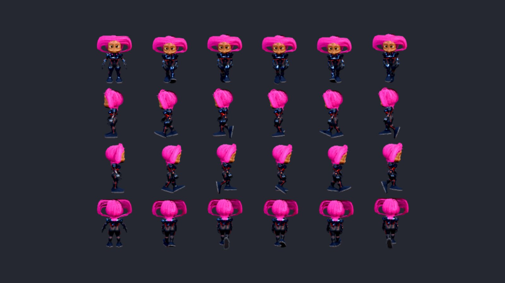

# RPG Reactor 0.99.3 (in development)

Work since 0.99.2. The full technical list is in the [editor changelog](../editor/changelog/0.99.3.md).

0.99.3 fixes lost surface detail after Builder exports, inconsistent chibi sprite frames, drifting model rotation after zooming, slow thumbnail loading and incomplete Structures editing. It also adds visible worn equipment, the Tactical Grappler, configurable height reach, HDR effect previews and deployment asset trimming.

### Highlights

The Character Builder and exported materials share their surface settings.

Exported models keep their detail; saved thumbnails load first and camera rotation stays centred after zooming.

Every direction and animation frame keeps the selected chibi proportions.

Face exports retain the studio's colors and lighting.

Nested buildings stay present when a blueprint becomes editable pieces.

Described rooms, paving and manually placed pieces open together for editing, with shared tool controls and visible help.

### Added

- **Don't bundle unused files** (a box in Deploy Game › Unused Files, and in Deploy Editor for the bundled project): a build ships only the pictures, sounds, movies, effects, models and fonts the game can load. Deploy Editor remembers it for each kind of package and starts it on for Web. Unlike RPG Maker's option it reads plugins too: a file is left out only when nothing names it, not the database, maps and events, plugin parameters, the code of the plugins switched on, the textures an effect loads, the files of a placed model, or what playtests loaded. **Review unused files** lists what would be left out with a Keep button, and an **Always include** list is saved with the project. On the Demo a Web build goes from 1,160 files and 450 MB to 887 files and 271 MB.

- **The Grappler**, a gauntlet that shoots a harpoon. Find it in the 3D Character Builder (Accessories › Bags and tools) and the Prop Builder, in Tactical, Brass or Salvaged style. It fits any arm, gathering a loose sleeve under it. In a Tactical battle a wearer's grapple fires the harpoon from the barrel on its line, and the barrel stays empty until it is wound back.

- **HDR effects in the editor.** The animation previews draw an HDR effect with its bloom and grade, and an HDR checkbox compares it with the normally graded copy.

- **Equipment you can see.** Pick a Prop Builder wearable as an armor's 3D Model (Database › Armors), and every party member who equips it wears it on the map and in battles on the map, fitted to their own body and moving with it. The Grappler worn this way is where a Tactical grapple fires from. In the Demo, Fleagus, Carol and Jolt wear the Grappler.

- **Grapple in the unit's menu.** A unit wearing a grapple can choose **Grapple**: only the roof edges and ledges it reaches are shown, the view turns to them with the roof drawn, and a click or Enter takes one. Teal edges in the ordinary move range can now be clicked even where the battle had cut that roof away.

- **Grappling looks and sounds like it.** The line is a cord that flies out slack, draws taut as the hook bites, and then pulls its wearer up; the cinematic camera cuts with each beat, and the armor's Grapple section has a sound for the shot, the hook biting and the pull (the Demo's Grappler has all three). **G** in a move shows only where the grapple reaches, and the cursor says *Grapple* on an edge.

- **Four new Demo characters** from the 3D Character Builder: Elija and Rosanna (priests: a chaplain's coat, a field medic's suit), Rhea Voss (a recon sniper) and Dex Marlow (an EVA technician). Rhea and Dex were recolors of Carol and Jolt. All four have face sets for messages and menus.

- **North Haven's militia are their own people.** The Conscript, Rifleman, Guard, Marksman and Medic are 3D Character Builder characters in one olive-and-khaki uniform with an amber shield insignia, each recognisable by role from the battle's camera; they were recolors of the heroes. Rhea, who leads them, is the Rhea Voss model in the square and in the battle.
- **Height reach you can set.** A shooter on higher ground reaches further: one tile for every two levels up, three at most, as before. Change that for the whole game in Database › System 1 › Battles, or for one weapon, skill or item in its Combat card (a sniper rifle that gains a tile a level, a pistol that gains nothing).
- **See how far an attack reaches before choosing it.** In a Tactical battle the cursor on Attack, a skill or an item in a unit's menu marks its reach on the field, also when Attack is greyed because nobody is in reach yet.

### Changed

- **Effects sit in the scene.** Battle and map effects draw under the windows and take the screen's tint, as in RPG Maker MZ.
- **Effekseer runtime updated to 1.80.7.**

### Fixed

- **3D Models load saved thumbnails first.** Folder thumbnails appear as the list opens; only missing pictures are rendered and saved for future sessions. Existing artwork is kept.
- **Structures open the complete blueprint for editing.** Rooms, paving and nested buildings stay present alongside manually placed pieces, including their attached content when saved. Structures and the map share tool buttons, and builder help stays clear of the toolbar, including on smaller windows.
- **Builder characters keep their surface detail after export.** Normal, glow, roughness, metalness and occlusion pictures survive model loading. Database previews show Builder GLBs under studio lighting, and exported materials retain the Builder's metal, cloth, skin and hair settings.
- **Zooming in and out in Database › 3D Models keeps rotation centred on the model.** Rig editing still zooms toward a pointed marker.
- **RPG chibi sprite export keeps its proportions in every frame.** A background preview rebuild could replace the chibi copy midway through a sheet. Interrupted exports restore the character and view too.
- **Face sheets keep their skin colors**, without the extra exposure and brightness grade used for small sprites. Model exports also keep one design throughout texture encoding, even if controls change.

- **Q and E keep turning a Tactical battle's view** after you click another window. A key config plugin put its own keys back whenever the game lost the focus, taking the battle's with them (and the jump key on 3D maps).
- **Metal parts of 3D Builder characters and props look like metal in the game**, as they did in the Builder, instead of plastic.
- **Select Face in Show Text works in a popped-out event editor.** Clicking a face, Cancel and × did nothing there; they close the picker again, and the picker says that clicking a face uses it.
- **WebGL errors in the console during effects and while a map loads.** Battle and map effects no longer flood the console with *Feedback loop* and *Invalid copy* errors, and Character Builder clothes no longer warn *Texture marked for update but no image data found* as they load.

- **Games that edited RPG Maker's own scripts** keep those edits: Braver's challenge hut passcode counter no longer stops the game (*DataManager.encode is not a function*), and its permanent states, battle items usable while unable to move, whole-number HP, MP and TP, spawn items, Battle Prep transitions and the F5 option work as in the original game.
- **Plugin parameters:** an optional struct field is left empty instead of being saved as 0.
- **Walking 3D characters keep their legs under them.** The right leg no longer kicks out to the side in the 3D Character Builder's walk and in the game's own walk for rigged humanoids, and a running knee no longer flares out. Save a Character Builder character again to carry the new walk.
- **Followers catching up** step in time with the ground instead of sliding.
- **Q and E** turn the battle view with a unit's menu open too.
- **Hovering a roof** no longer makes the battle's view jump: the pointer on a roof turns nothing and the cut stays put while it crosses it.
- **Armors and Weapons pages** lay their sections in two columns that stack on their own: no empty card under Combat.
- **Mount in a Tactical battle:** a unit beside any part of a parked vehicle can get on it again. Before, it had to stand beside the vehicle's middle, which was often taken.
- **The Grappler's bracer** has an inside wall: looking into the cuff no longer sees through it.
