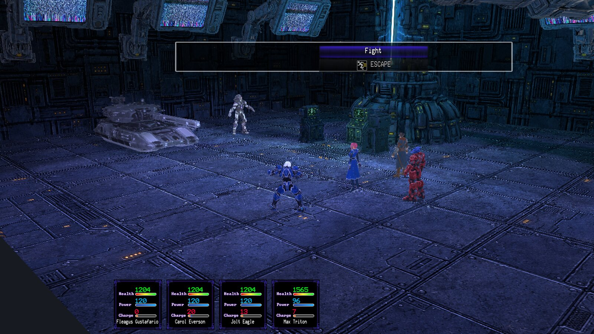
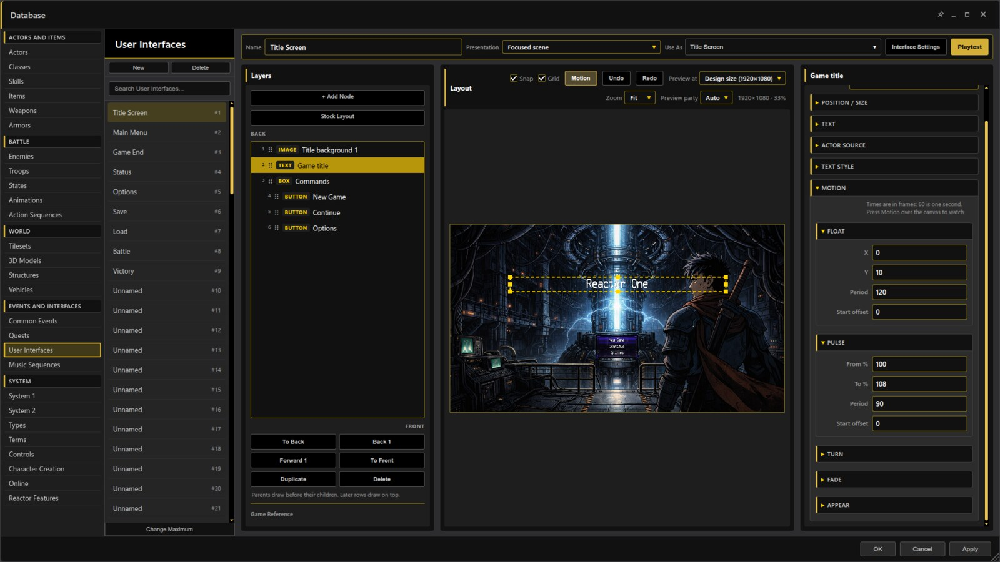
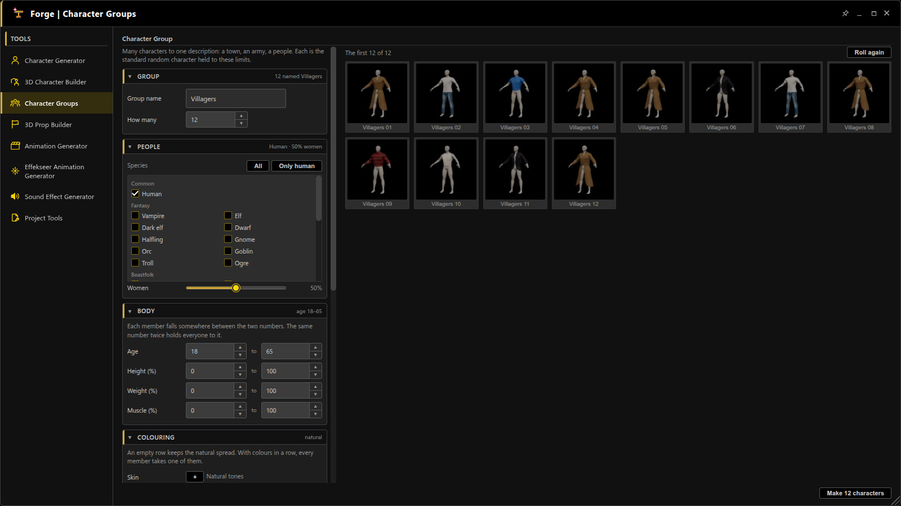
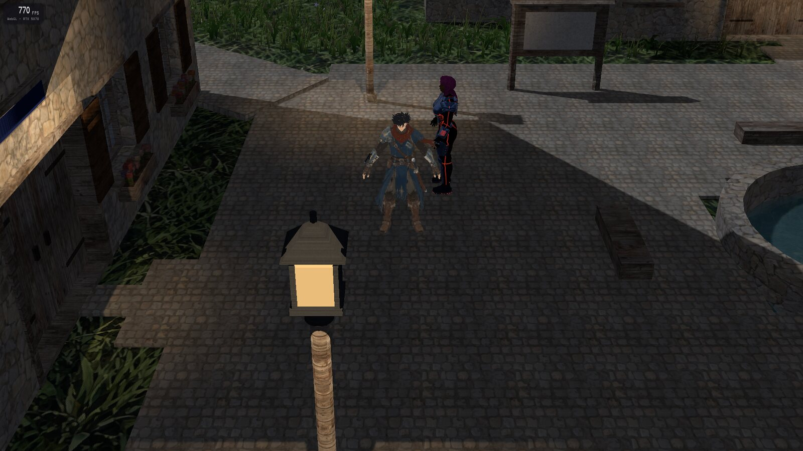
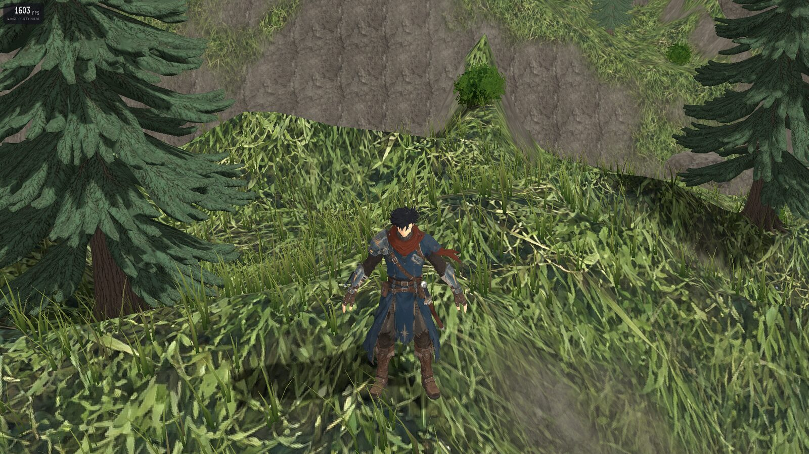
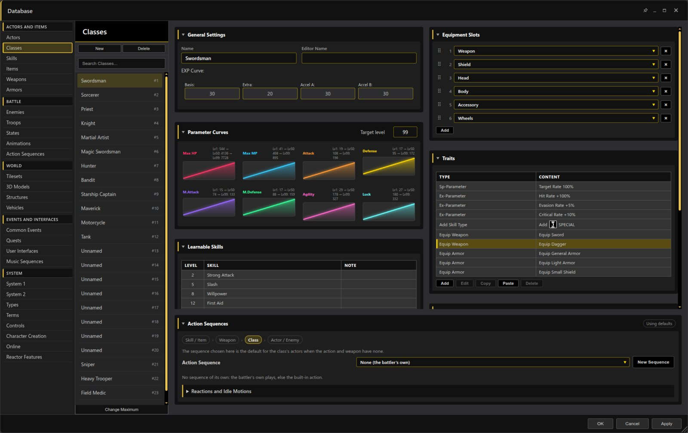

# RPG Reactor 0.99.5 - 2026-11-12

## Highlights

Fight battles together online, fill a town with generated characters, build interfaces from pictures that move, and run faster on weak and strong computers alike. This is the 0.99.5 source release. The whole test suite ran before the cut: 9,718 of 9,737 tests passed and 8 failed (seven long-standing failures and one timing test that passes when run alone). Packaged downloads and native binary validation are tracked separately.

## Pictures

Classic battles in a Battle Room are drawn the way maps are, at the machine's real frame rate.

Fill interface elements with pictures and give them motion in Database → User Interfaces.

Character Groups makes a town, an army or a whole people from one description.

Games run without vsync; F2 shows the real frame rate and the graphics device.

High ground rises at the edge of an Open Road map.

Database pages deal their cards into columns of near the same height.

## Play together online

- **Shared battles:** walk up to another player's Tactical battle to join their side, join the enemies or fight for yourself, or only watch. Classic, Action and First Person battles can be joined too, vehicles included, and `/duel Name` challenges a player directly. If a host leaves, the battle carries on with another player.
- **Parties:** `/invite` players into a party with its own chat channel, `/follow` a member anywhere, and share switches and variables with the party.
- **A clear start for new players:** New Game offers Create an account, I have an account or Play as a guest. The sign-in and character creation pages are real game windows in the project's window skin and font, and work by keyboard, gamepad, mouse and touch. The Character Creation event command can skip it for returning players, require it, or report how it ended, and it now works in playtests.
- **Characters made in the game:** they get their rig, poses and a portrait made from their own model, load faster, and try on each species, outfit or hair as you move through the list.
- **Staying in the world:** no Game Over online (a knocked-out player gets up where they entered the map), sleepers wake where they slept, a menu save also saves to the account, and a line on the map shows the chat and voice keys.
- **Safer servers:** nobody can take another player's name or act in their place, bad messages can no longer stop a host or the server, and Database → Online sets how much room uploaded characters may take.

## Characters, interfaces and the editor

- **Character Groups:** say who may appear (species, share of women, ages, builds), how they dress and how many; the Forge makes them all, each with a saved design, a walking sheet, a side-view battler and a portrait.
- **Sprites from the 3D Character Builder (experimental):** press Sprite to see the sheet itself with every animation playing, and preview a sheet before exporting it. The pictures on the Builder's tiles now come with the editor and no longer redraw as you change your character.
- **User Interfaces, pictures:** boxes, buttons, lists and text fields can be filled with a picture (stretched, fitted, tiled or nine-sliced), with their own pictures when selected, pressed or disabled. A list's rows and a gauge's bar can be pictures too.
- **User Interfaces, motion:** any element can float, pulse, spin, sway, fade, or slide and grow in when its interface opens. A picture can be a sheet of animation frames or scroll inside its box, and whatever is placed inside an element moves and turns with it. Press Motion over the canvas to watch it without playtesting.
- **Enemies can wear equipment:** turn on Database → Reactor Features → Enemy Equipment to give enemies weapons and armor; an event command changes them in battle. Contributed by Xehanort88.
- **Editor:** pop-out windows gain pin, minimize and fill-the-monitor buttons and resize from any edge. Database pages come out in even columns. A new Cliffs edge style raises high hills at a map's edge, as on the Open Road maps. The Character Builder, Prop Builder, User Interfaces editor and Database windows are translated in all 17 editor languages.

## Faster on every machine

- **Real frame rates:** games run without vsync, as fast as the machine allows, in battles as on maps. F2 shows the frame rate, the game's own work per frame and the graphics device.
- **Automatic quality that knows what a computer is short of:** it times the graphics card and the processor apart and lowers only what is slowing that machine. Levels are remembered per computer. A machine with room to spare now draws the 3D world at full resolution, where it was always drawn at three quarters and enlarged.
- **Weak laptops:** on a laptop with Intel Iris Xe graphics the Demo's first room went from about 31 to 38 frames a second early in this cycle, with later gains in battles, towns and map loading. On Windows the game tries the ways it can reach the graphics card and keeps the fastest.
- **Crowds:** characters far away, lying still or out of view cost much less; characters made in the game draw in about 8 pieces where they took 17 to 39; character pictures take far less video memory. North Haven's square with its crowd draws about half as much as before.
- **Maps:** lamps are drawn together, empty tile layers are skipped and plain-coloured models draw in far fewer pieces: the Demo's first room takes about a fifth fewer draws a frame. Maps open faster, and the first seconds after arriving stutter less.

## Fixes

- **Two audits of the whole app:** every part of the editor and the game was read through twice and several hundred faults were fixed, in event commands, the Database, the map editors, battles, vehicles, saves, imports from RPG Maker 2000 to XP, and building. Most were found by reading the code and are checked by automated tests only.
- **In the game:** a message box could open with no face or text; walls showed through roofs; shadows flickered, trailed behind vehicles or appeared late; the party kept its swimming pose after leaving water; wandering characters stepped onto doorways; the Star Shift games stopped at New Game. All fixed.
- **In the editor:** event changes lost after Undo, unsaved Plugin Manager changes dropped without asking, custom biomes that would not save, and the row of open windows sitting on top of the Database.

## Known issues and updating

Eight tests fail in the whole run; CI last ran green on 2026-11-02 and has not yet run on this release. The audits' fixes were made by reading the code, and most have not been seen in the running game or editor. The speed work was measured on two machines (an RTX 5070 desktop and an Intel Iris Xe laptop); the newest pacing, Battle Room and interface-motion changes still need their check on the laptop. Online features have been exercised on one server, and this cycle's last server changes are not deployed to it yet. The bundled Demo ships set to single player with Character Creation off; turn them on in Database → Online and Database → Character Creation. Character appearance remains under review, and native binary validation remains open.

Restart the editor and playtest after updating. Characters made in a game need making again to get their rig and clean clothing. The first start after updating compiles the game's shaders again and is slower once.

Read [every change in plain words](../docs/archive/changelog/0.99.5-every-change.md), the [technical changelog](../editor/changelog/0.99.5.md), the [online guide](../docs/DESIGN-ONLINE.md), the [User Interfaces guide](../docs/DESIGN-USER-INTERFACES.md), the [performance notes](../docs/PERFORMANCE.md) and the [open items](../docs/OPEN-ITEMS.md) for details.
