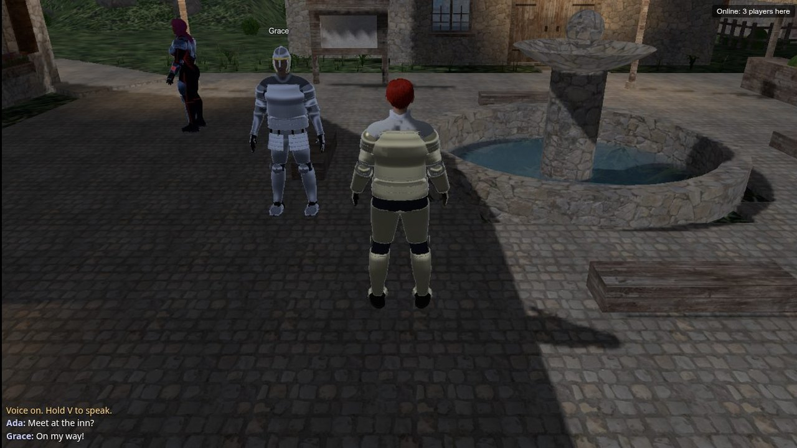
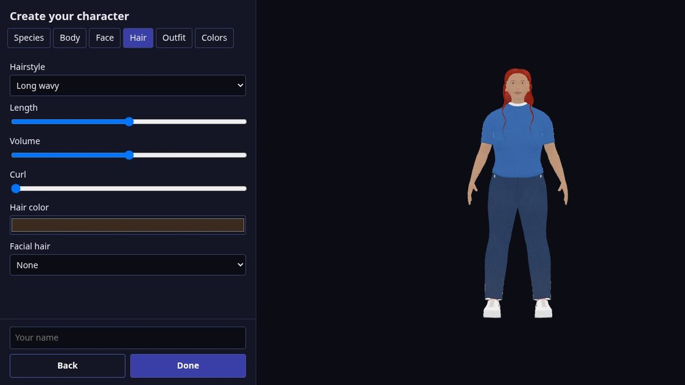
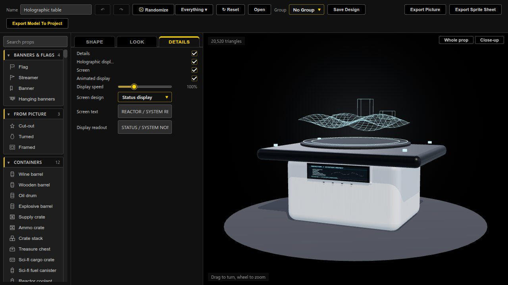
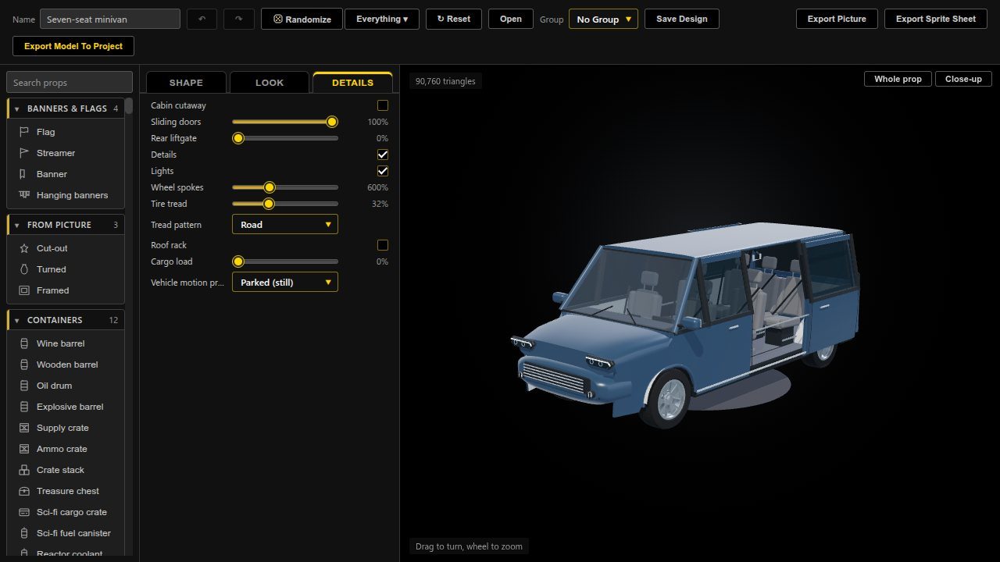
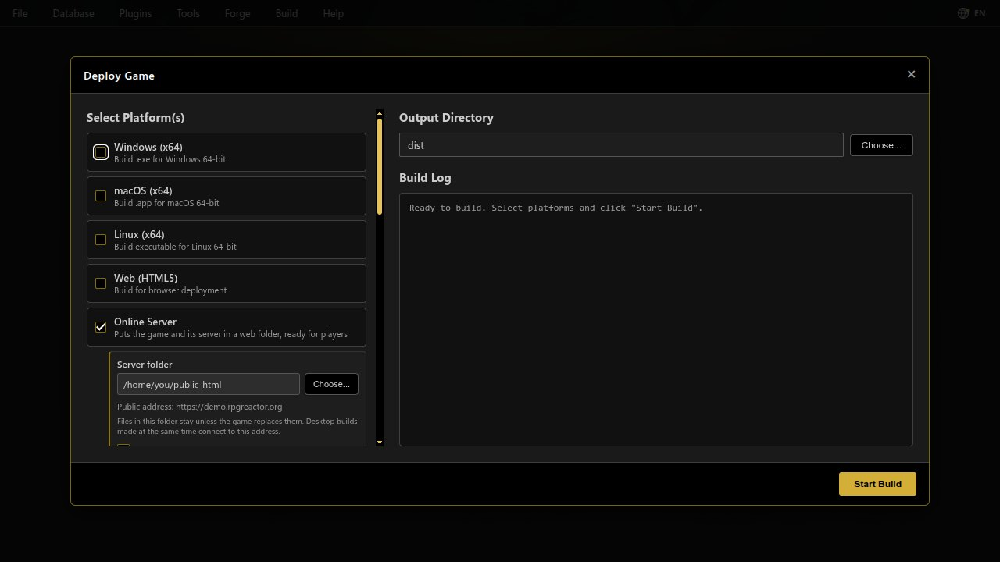
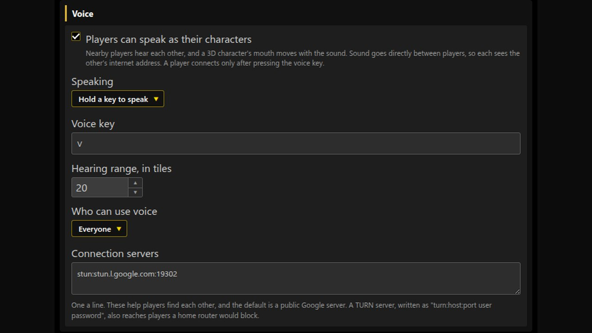

# RPG Reactor 0.99.4: Online Worlds and In-Game Character Creation

RPG Reactor 0.99.4 is now on GitHub! Since our last update, we’ve added:

**Online worlds.** Multiplayer games with accounts, chat, persistent characters and shared world state.

**In-game character creation.** Let players choose and customize their characters in single-player or online games.

**More character controls.** New exercise and resting poses, adjustable body bounce, skin finishes and smoother live sliders.

**Props and clothing.** Refined materials and construction, medical and Wasteland props, and editable holographic displays.

**A cabin you can use.** The seven-seat minivan has sliding doors, a liftgate and a cabin cutaway.

**Deploy your online world.** Online Server writes your game and its PHP server into a web folder.

**Avatar voice.** Early proximity voice support, with character mouths moving as players speak.

**Export and editor fixes.** Improved model previews, complete Structures editing, corrected multi-frame walking sheets and events that stay aligned while the map scrolls.

Online features are still early and need more real-world testing. Existing generated models should be re-saved to receive the latest improvements.

[Get the source release and read the full notes](https://github.com/Psychronic-Games/RPGReactor/releases/tag/v0.99.4).
