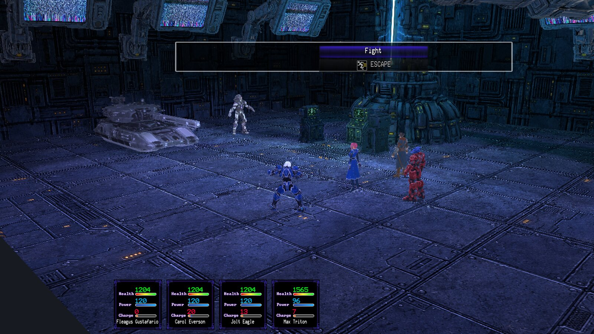
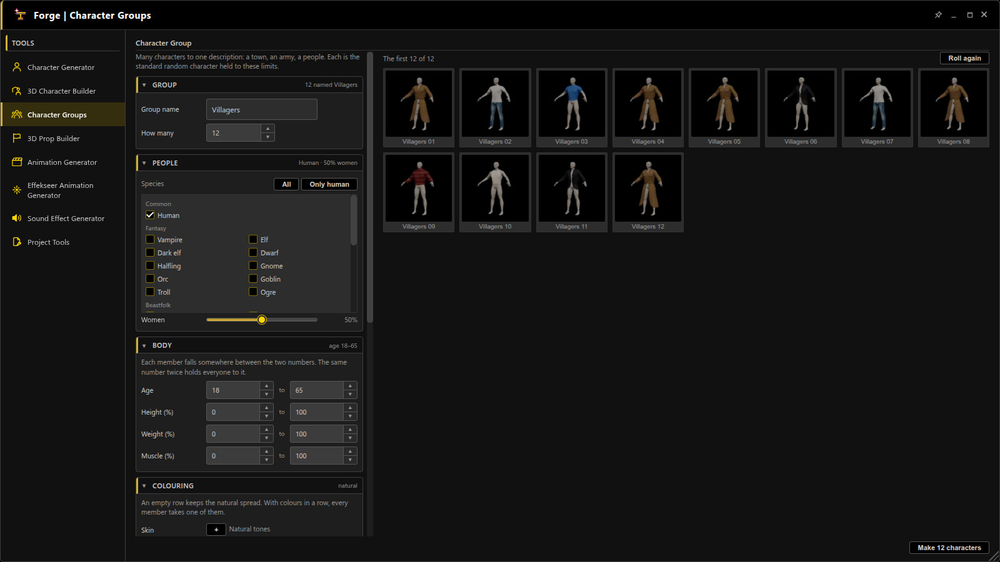
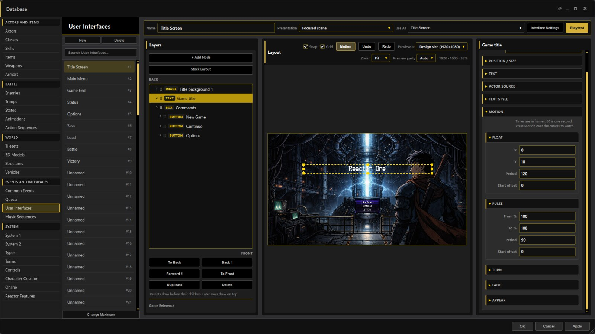
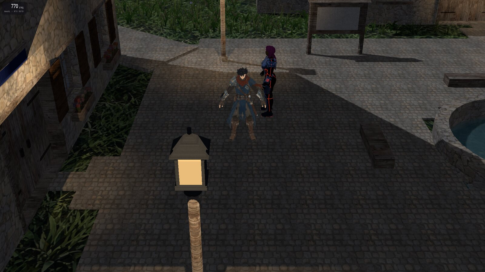
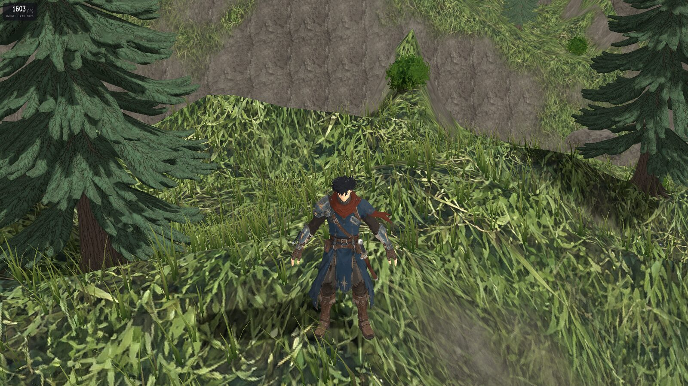
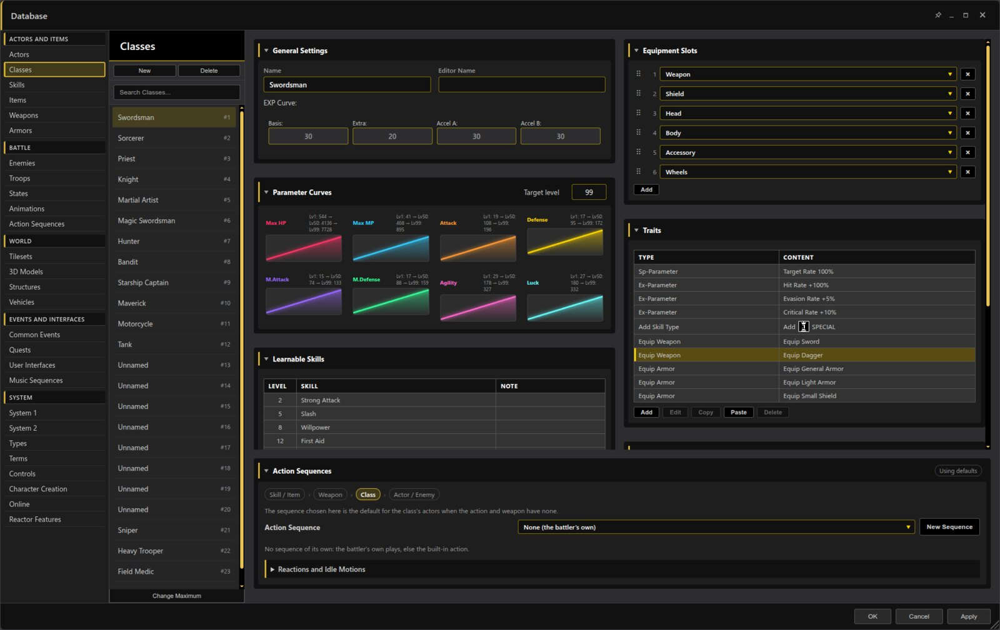

# RPG Reactor 0.99.5: Shared Battles, Character Groups and Moving Interfaces

RPG Reactor 0.99.5 is now on GitHub! Since our last update, we’ve added:

**Faster battles.** Classic battles in a Battle Room are drawn the way maps are, and every battle shows its real frame rate.

**Battles and parties online.** Join another player's battle on any side, watch it, or challenge them to a duel. Form a party with its own chat, follow a friend and share switches.

**Character Groups.** Describe a town, an army or a whole people and the Forge makes every member, with sheets, battlers and portraits.

**Pictures and motion in User Interfaces.** Fill boxes, buttons, lists and gauges with pictures, play animation frames, and make any element float, pulse, spin, sway or fade.

**Real frame rates.** Games run without vsync, and F2 shows the frame rate and the graphics device.

**Faster on weak and strong computers.** Automatic quality lowers only what a computer is short of, draws at full resolution where there is room, and makes crowds and maps far lighter.

**A tidier editor.** Even Database columns, pop-out windows that pin, minimize and resize from any edge, and translations in all 17 languages.

**Hundreds of fixes.** Two read-throughs of the whole app fixed several hundred faults in event commands, the Database, battles, imports and builds. Enemies can now wear equipment, contributed by Xehanort88.

Most of the audit's fixes are checked by automated tests only, and online features are still early. Characters made in a game need making again to get their rig and clean clothing.

[Get the source release and read the full notes](https://github.com/Psychronic-Games/RPGReactor/releases/tag/v0.99.5).
