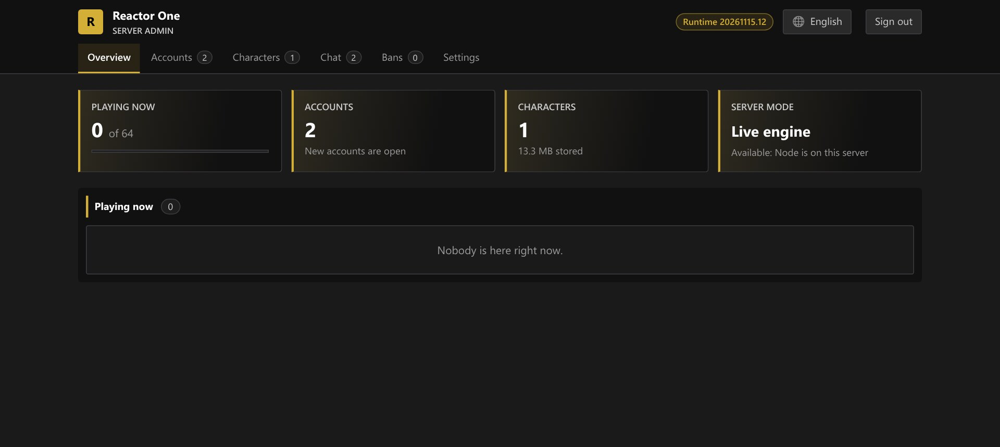
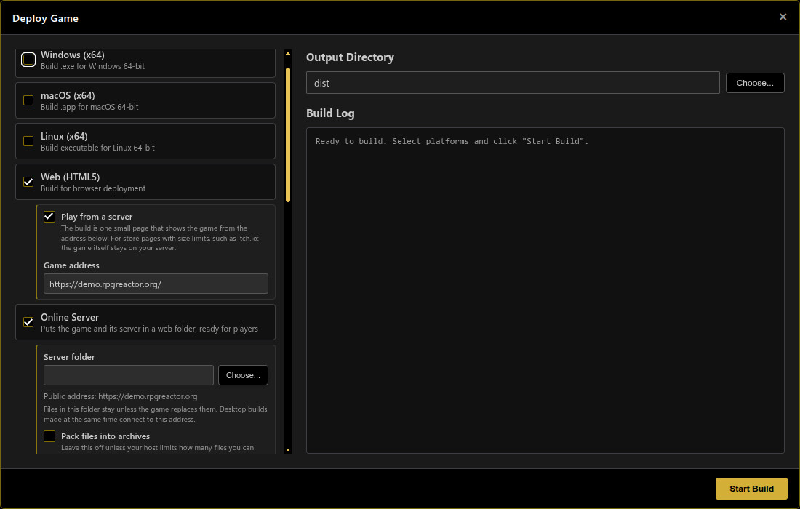
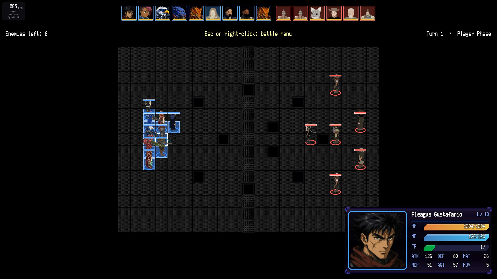

# RPG Reactor 0.99.6: Your Own Online Server, Faster Deploys and Graphics Backends

RPG Reactor 0.99.6 is now on GitHub! Since our last update, we've added:

**An admin page for your online server.** Every online game you deploy comes with a page to look after it: who is playing, accounts, the characters players have made, bans and settings, drawn like the editor in the theme you work in.

**In 18 languages, with a live chat.** Read what players say as they say it, and write to everyone or to one player. A player who is away reads your message the next time they play.

**Play from a server.** A Web build can be one small page that shows the game from your own server. Upload it to a store page such as itch.io and its size limits no longer apply; every deploy to your server is what players see.

**Faster deploys.** Build → Online Server sends only the files that changed.

**Graphics backends and speed.** Choose how a game reaches the graphics card (Auto, Direct3D 11, Direct3D 11 on 12, OpenGL or Vulkan). Video screens play on Vulkan and no longer keep a processor core busy, and maps load without the long first stall on more graphics drivers.

**Maps above and below, faces that talk.** A map can have a map under it and one over it, joined by openings and ladders. Face sets can talk in the message window, their mouths following the words.

**Music that loops where it should.** Opus and Ogg Vorbis music loops at its tagged points in the game and in the editor's previews, contributed by Xehanort88.

**Fixes from playing online:** weapons at the right size on 2D maps, created characters fighting as themselves, wide ladders you can move along, and more.

[Get the source release and read the full notes](https://github.com/Psychronic-Games/RPGReactor/releases/tag/v0.99.6).
