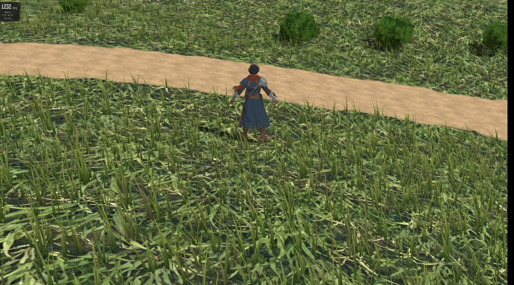
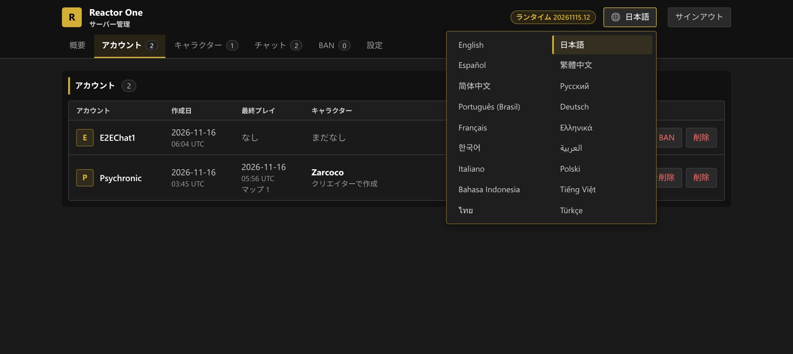
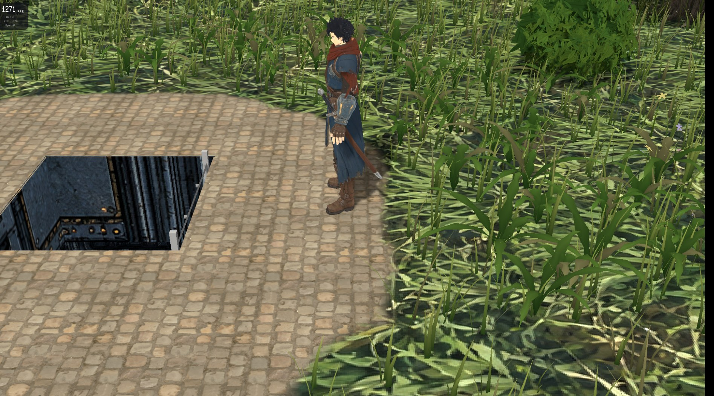
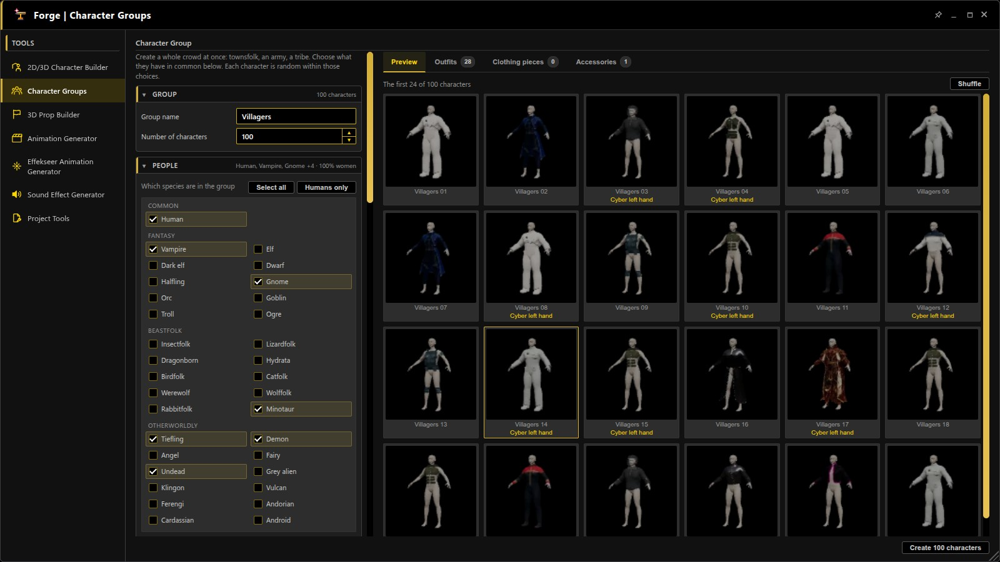
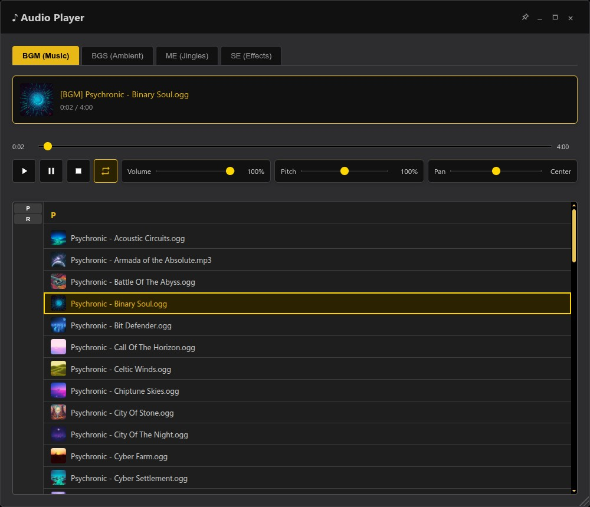

# RPG Reactor 0.99.6: Faster on Every Computer, Your Own Online Server, and Maps Above and Below

RPG Reactor 0.99.6 is now on GitHub! Since our last update, we've added:

**Improved performance and optimization.** Games run faster and smoother on low-end and high-end hardware alike. Maps open without the long first freeze, battles no longer stutter, and the frame rate matches your monitor. Each computer picks its fastest graphics backend on its own, or you choose: Direct3D 11, Direct3D 11 on 12, OpenGL or Vulkan.

**Run your own online game.** Every online game you deploy comes with an admin page that looks like the editor: who is playing, accounts, the characters players have made, bans and settings.

**Talk to your players, in 18 languages.** Read the chat live and write to everyone or to one player. A player who is away reads your message the next time they play.

**Your game on itch.io, straight from your server.** A Web build can be one small page that shows the game from your own server, so a store's size limits no longer apply. Deploys send only the files that changed, so an update is quick.

**Maps above and below.** Put a map under a map and one over it: a cellar under a house, the floors of a tower, a room beneath a town. You see through the openings, and fall or climb through them with no loading screen. Ladders are climbed hand over hand, and wide ones let you move side to side.

**Characters with more life.** Faces talk in the message window, their mouths following the words. The battle camera swoops to whoever is acting, and a finishing blow plays in slow motion. Character Groups dress a whole town from a picture catalog and can make every member a 3D model.

**Battles your way.** Each troop can have its own battle mode, players choose how often the camera cuts in, and 3D characters fight Tactical battles on 2D maps.

**A better editor.** The Audio Player is a window of its own that stays open while you work. Music loops at its tagged loop points (contributed by Xehanort88). The Loop command counts and repeats, and a game can open with your splash screen.

[Get the source release and read the full notes](https://github.com/Psychronic-Games/RPGReactor/releases/tag/v0.99.6).
