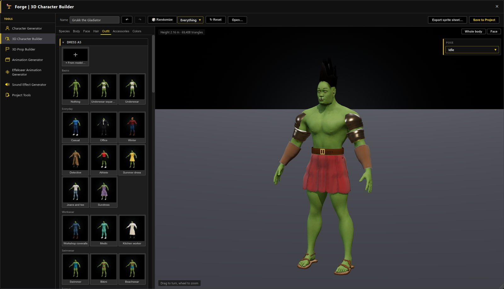
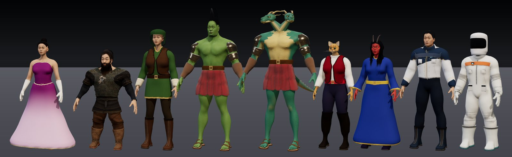
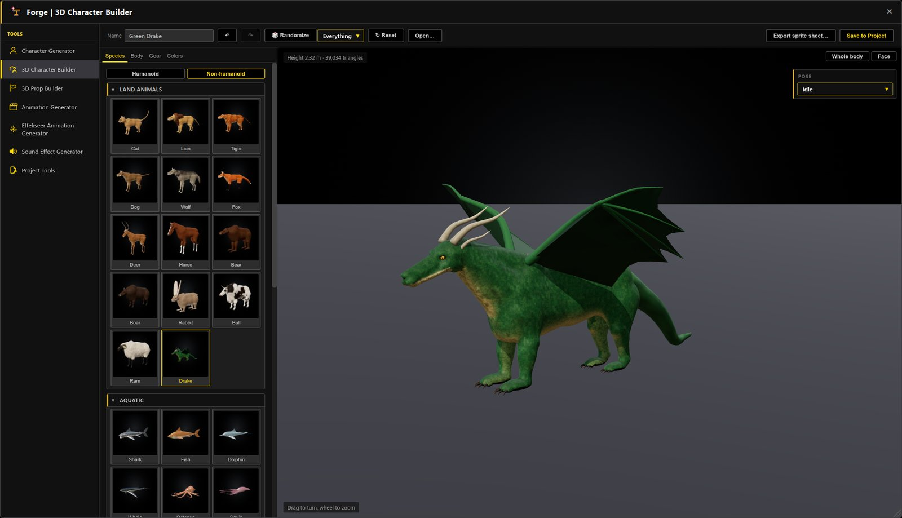
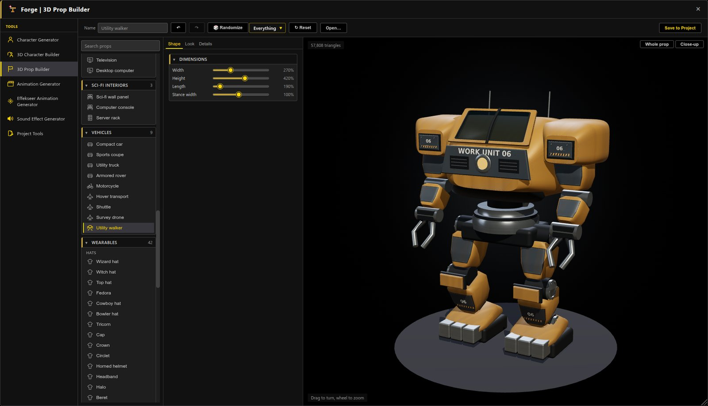
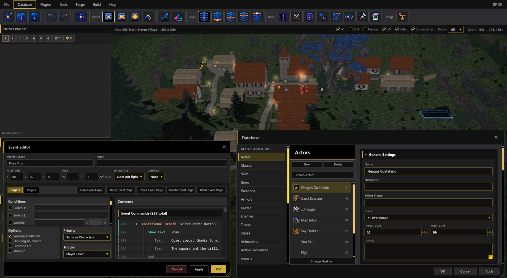
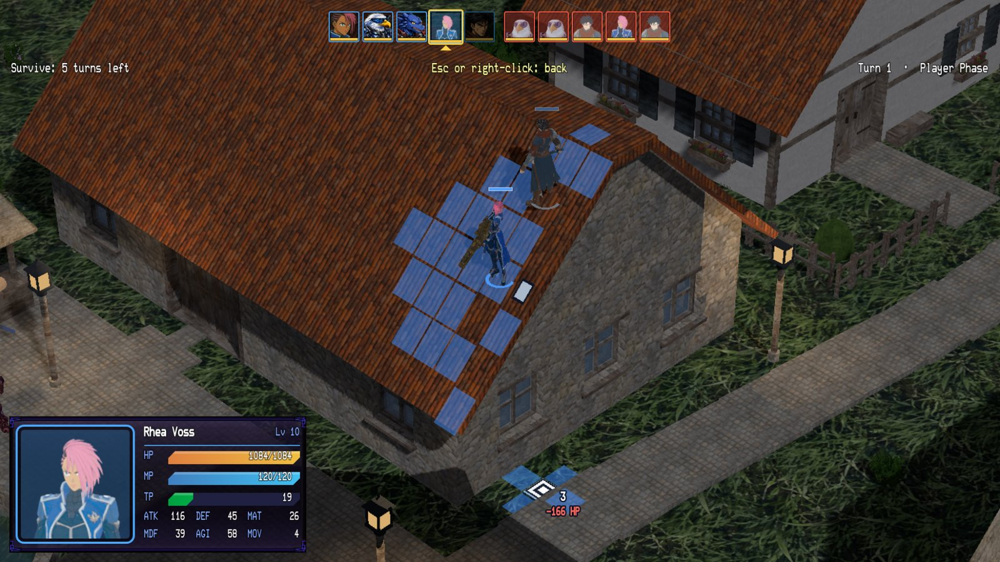
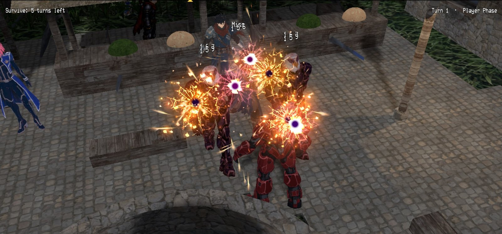

# RPG Reactor 0.99.1: 3D Character and Prop Builders, Climbing and Grappling

0.99.1 adds the Forge's 3D Character Builder and 3D Prop Builder: people of dozens of species, animals, birds, insects and sea creatures, clothing and armor, furniture, props and vehicles, saved as rigged 3D models. The Database, the event editor, the Forge and plugin settings open in windows of their own. Battlers climb walls, jump down roofs and grapple up to ledges. Maps join with no stall at the border, Effekseer effects match RPG Maker MZ's size, self switches run from A to Z, and games run smoother on weak hardware. The full technical list is in the [editor changelog](../../editor/changelog/0.99.1.md).

[Download the binaries on itch.io](https://psychronic.itch.io/rpg-reactor). GitHub provides the source release.

### Highlights

**3D Character Builder:** Build your hero with sliders and pickers, dress them in a click, and save a rigged 3D model that walks, runs and fights.

**Dozens of species:** Humans, dwarves, elves, orcs, two-headed dragonkin, catfolk, tieflings and starship crews, all from one builder.

**Creatures:** Add dragons, wolves, horses, sharks, birds and insects to your world, each saved as a rigged 3D model.

**3D Prop Builder:** Make vehicles, furniture, sci-fi consoles, weapons and treasure chests, then drop them straight onto your maps.

**Windows of their own:** Keep the Database and the event editor open beside your map, or move them to a second monitor.

**Climb, grapple and jump:** Send units up onto roofs and see the fall damage before they jump back down.

**Effects in battles on the map:** Effekseer skill effects burst right on the map in Tactical battles, with the camera moving in on the action.

**The world in 3D:** Walk a lamplit village at night, with maps that join with no stall at the border.

### Changed

- **Climb and jump down in battles:** battlers climb walls onto roofs and ledges without a ladder, and jump down any height. Past the safe fall they take the fall damage from System 2 › Physics, and the move preview shows it. Lethal jumps can ask first, be allowed without asking, or not be offered; the AI never takes one. Climbing and battle falls are set in System 2 › Physics.
- **Grappler:** an accessory with a Grapple section on Database › Armors (reach, highest edge, uses, cooldown, cost) pulls its wearer up to a roof edge in a Tactical battle. The Demo's Fleagus wears one.
- **Buff Rate:** Traits › Rates › Buff Rate sets the chance a buff is accepted, per parameter; 0% blocks buffs. Thanks to Xehanort88 ([#77](https://github.com/Psychronic-Games/RPGReactor/pull/77)).
- **Crossing between maps:** no shader compiling or map re-reading on the crossing frame; the crossing is down to about one missed frame.
- **Neighboring maps in the editor's 2D view:** the neighbor's tiles show dimmed past the edge, view-only, under the Surroundings toggle.
- **Character and Prop Builder:** round parts get detail by size, so clasps, studs and rivets cost a tenth of the triangles and large domes are smoother. A Jewelry character went from about 103,000 to 72,000 triangles.
- **North Haven:** the tree in the central square is gone, so Rhea's roof sees the raid.
- **Self switches A to Z:** event pages, Control Self Switch and Conditional Branch offer every letter from A to Z. Projects that use A to D play as before.
- **Effekseer animations at MZ's size:** Classic battles and 2D maps draw effects at RPG Maker MZ's size (they were about 0.79 of it), and animations center on the target unless they have Align Bottom. Battle Room Action Sequence steps start at the Classic size, and the Database previews and animation pickers draw at the game's size.
- **Battles on the map:** troop event pages run in Tactical, Action and First Person battles with the same conditions as on the battle screen. In Action and First Person, followers hold back until the leader attacks or drops below half HP. The Action HUD fades under messages and the victory results, and a Tactical unit panel fades when it covers a unit or the cursor.
- **Vehicles:** Get On lists only named or placed vehicles, and Set Vehicle Location can move a map's vehicle events. The Demo's motorcycles are Starting Positions.
- **Build:** right-drag turns the view while building, Q and E only change the level, and Escape in Select with nothing selected leaves Build. A Storeys list cuts the editor's 3D view like the game's cutaway. Room and Sky moved from Map Properties to Build › Terrain, with live preview.
- **Neighboring maps:** events near a shared border are built before the crossing, so parked vehicles no longer pop in. In the game, a 2D map draws its neighbor's tiles past its edge.
- **Events and maps:** Paste Event Page overwrites the page in view. Circle fits the drag (Alt grows from the center). New Map takes the selected map's tileset and opens after OK. File › Save Project As. A blank project starts with one actor. Escape, × and Cancel close the Event Editor, asking first when there are edits.
- **Database:** the menu and sidebar group the pages into five sections; each record has one Combat section; a state's motion is set in one list; Physics and Swimming moved to System 2; Battle Room Setup folds its camera numbers. Cancel asks before discarding edits. Troops show the battleback of the map that starts their battle.
- **Deploy:** optional asset encryption in MZ's format. macOS bundles carry the game's name and id, and Linux on Automatic ships the normal build instead of the SDK.
- **Forge:** one Forge menu entry. The Character Generator saves a recipe beside each sheet and can reopen it, and always bottom-aligns walking sheets. Database › Animations can fill a sprite animation's frames from a sheet. Optimize reports its triangle result.

- **Vehicle lettering and forms:** replace damaged alpha-text captions with filled glyph outlines; filter fine material grain before baking to prevent aliased dents/streaks. Add formed window apertures, crowned roofs, smooth shoulders, shaped tires and airfoil stabilizers. Expose clay comparisons and distinguish technical checks from visual acceptance. Preview47; reload/reselect and rebuild/re-save existing GLBs.
- **Vehicle surfaces and cabins:** add baked paint/normal/material maps, distinct rubber/metal/trim/fabric, four coating finishes, editable service/rally markings and controlled wear/grime. Add fitted seats, headrests, instruments and steering hardware behind adjustable glazing. Fix preview UV refresh after texture repacking and let light reach transparent cabins. Preview46; reload/reselect and rebuild/re-save older vehicle GLBs.
- **Vehicle bodywork:** rebuild all nine transports with formed coachwork, fitted panels, airfoil wings, turbine assemblies, motorcycle final drive/fairings, drone gimbals/rotor guards and plated walker mechanisms. Add secondary body paint and visible equipment variants. Fix section shading bands and fit details to their actual surfaces. Preview45; reload/reselect and rebuild/re-save older vehicle GLBs. [Coverage and limits](../../docs/PROP-BUILDER.md).

- **Character and prop corrections:** turn suitcase grips upright, give rover doors wheel clearance and supported steps, round vehicle tire shoulders, enlarge barrel warnings, and add editable screen text to consoles and other electronics. Slim and reshape medieval plate, revise sci-fi suit panels and heel counters, rebuild bird wing folding with a separate manus joint, and remove pore-map bands from furred coats. Move Star Crew and Star Shift presets into Sci-fi; replace the Modeled category with clothing-use groups. Preview44; reload/reselect presets and re-save generated GLBs.

- **Procedural construction and detail:** add shared deterministic assembly rules for props and character equipment. Build distinct furniture joinery/chassis, formed upholstery, engraved keyboard layouts, curved vehicle glazing and fitted hardware, layered firearms and helical sword grips. Rebuild guitar, umbrella, bow tie and choker forms; add shared material relief. Fix inactive finish/color controls, container atlas overflow, tall-banner cross/repeat placement and inward tire tread. Audit every visible type and exposed control, including dependent settings. Preview43; reload and rebuild/re-save older models. [Coverage and limits](../../docs/PROP-BUILDER.md).

- **Prop catalog quality and vehicles:** put basic/everyday outfits first. Rebuild the console deck, cabinet and supports together; correct furniture/monitor contact, close screen housings, and add furniture layout, material and display controls. Refine shared caps, bags, tools, masks and jetpacks; add supported firearm coils, receiver hardware and grip ribs. Add nine configurable vehicle models with grounded construction and ground-vehicle wheel metadata. Review every visible prop and all 37 supplied prop references. Preview42; reload and re-save revised models. [Coverage and limits](../../docs/PROP-BUILDER.md).

- **Warrior clothing, birds and room props:** replace flat warrior apron sheets with layered leather wraps fitted over their lining; refine eagle anatomy and feathered wings, ground folding and flight posture. Correct Data Crate halo alpha and sharpen cargo lettering. Add 16 editable furniture, appliance, electronic and sci-fi interior types, including seating, beds/storage, refrigerator, microwave, television, desktop computer, wall panels, consoles and server racks. Fix tiled prop materials and wide-object framing. Preview41; reload and re-save generated models.

- **Character selection and outfit quality:** fix the Body tab after species changes and preserve gender. Rebuild Recon with fitted knee cups, supported textile carrier/webbing and sleeve cups; tailor separate jacket/cargo trousers for Recon and Flight crew, with raised pocket flaps and folds. Speed up outfit surface fitting and keep species previews through unrelated edits. Preview40; reload, reselect presets and re-save GLBs.

- **Character poses and clothing:** correct crossed strides, wrist turns, guarding jitter and wave/fall/kneel/sword motions; rebuild gladiator rear panels and close Viking underarms. Add sewn sci-fi details, fitted recon shoulders, armor surface finish and original Field coat/Courier/Pathfinder/Utility harness pieces. Preserve fine anatomy between humanoid species. Preview39 / runtime20261022.1; reload and re-save GLBs. [Coverage and limits](../../docs/CHARACTER-QUALITY.md).

- **Remaining character fitting:** correct broad-body cloth folds, coat/dress waist joins, drifting sewn trim and angular collars. Keep fitted trouser legs separate, preserve modeled garment relief and form overlapping armor sections over the torso. Background cloth baking checks the sewn details too. Preview38; reload and re-save generated models. [Targeted follow-up and limits](../../docs/CHARACTER-QUALITY.md).

- **Character catalog detail:** add quilted gambesons, heraldic tabards, gem brooches and fitted animal bandanas/weather coats. Model garment bindings and sewn buttons, add padded/chain-mail relief and inner dress yokes, and correct stretched rear skirt prints. Fit animal capes through the shoulders and keep surface decoration from changing cloth rig sampling. Remove blocky fur artifacts and redundant coat layers; seat bird/bat eyes and refine parrot/flamingo bills. Slimefolk Face framing uses the actual eyes. Preview37; reload and re-save generated models. [Audit coverage](../../docs/CHARACTER-QUALITY.md).

- **Character preview ground:** keep the studio floor stationary when creature dimensions change; resize and recenter only the contact shadow in both rebuild and in-place updates. Checked with Goa'uld, horse, beetle and fish.

- **Clothing fit:** correct crossed skirt/coat waists and excessive returned hems, form power-armor chests along the torso, reduce recon plate stand-off, and groom animal fur beneath fitted tack. Correct dark preview shadow bands on animal cloth. Preview36; reload and re-save generated models. All 55 outfit presets receive sampled extreme-body checks; [visual coverage and remaining defects](../../docs/CHARACTER-QUALITY.md).

- **Character quality corrections:** attach Hydrata/Dragonborn/Lizardfolk necks beneath the rear skull, replace stretched neck scales with fine mapped relief, and seat vampire fangs against the upper lip. Rebuild cat breed faces, ears, coats and markings from photographic references, with finer fur geometry. Sharpen generated clothing atlases and add woven/leather surface detail for humanoids and animal gear. Preview35; reload/reselect and re-save generated models. [Coverage and remaining limits](../../docs/CHARACTER-QUALITY.md).

- **Hydrata, cat breeds and animal refinement:** add a two-headed dragon humanoid with joined necks, horns, scales, a tail and separate animated head bones. Cats gain softer faces, whiskers and seven breed presets, including Ragamuffin, Ragdoll, Persian and Maine Coon. Move fly antennae clear of the eyes, refine tick anatomy and give the bald eagle a taller, leaner silhouette and broader wings. Preview34 refreshes pictures; reload/reselect and re-save generated models.

- **Creature quality and selection:** connect crab/lobster claw sockets and moving wing/abdomen joins; add finer insect, bird and bat detail, bee/wasp stingers, and a stronger bald eagle head with a hooked bill and white tail. Remove cross-family Body type choices; animal, subtype and humanoid selections now use their own defaults, with Undo/Redo preserved. Preview33 refreshes thumbnails; reload and re-save generated models.

- **Help → About:** theme-colored links, the shared distinct header/footer with a Close button, a smaller logo and a responsive two-column link layout. The body scrolls independently on small windows.

- **Insects, birds, bats and crustaceans:** rebuild beetle legs with separate front/middle/rear paths, jointed feet, wing cases and shell detail; add beetle types and detailed crabs with articulated pincers. Add Tick, Bee, Wasp, Mosquito, Fly, Butterfly, Dragonfly and Lobster, plus 11 bird types and three bat types with their own wings and rigs. Wing spread, appropriate creature controls, native motions and saved GLBs share the same generator. Reload to refresh revision-32 thumbnails; re-save existing generated models.

- **Clothed extremes and creature materials:** audit mixed clothing/body shapes across the catalog; refine smooth hood openings, sewn waist joins, wide-seat skirt clearance, merfolk tail winding and harness buckles; improve seated thigh/knee coverage, posed waist edges and hard-boot/lining motion. Fish gain clear overlapping scales, fin rays, varying polish and restrained iridescence; Goa’uld gain pebbled skin, wrinkles and deeper folds. Catalog thumbnails retain fine maps; GLBs preserve roughness and optional iridescence. Preview31 refreshes pictures; reload/reselect and re-save older generated models. Remaining rear-robe coverage, extreme clothing/armor fitting and collar defects are recorded in the [quality follow-up list](../../docs/CHARACTER-QUALITY.md#remaining-fitting-work-after-the-revision-31-audit).

- **Creature settings and surface quality:** move creature types and part choices into Body settings beside their sliders, including humanoid additions, merfolk tails and Slimefolk shape. Replace shark/fish gill lines with recessed, joined skin folds; refine fish scales and attach jellyfish tentacles to a rolled bell rim through fixed collars. Animal-head neck joins follow the head cut independently of clothing openings. Preview revision 30 refreshes catalog pictures; re-save existing generated models for changed geometry.

- **Shark and worm correction:** fit dorsal fins across the back without twisted sections and fill the missing anterior tooth rows in both jaws. Worm type now offers Earthworm, Tapeworm, Leech, Roundworm, Bristleworm and Goa'uld, with distinct ribbons, suckers, bristles or frilled heads and native crawling rigs. Preview revision 29 refreshes cached pictures; re-save generated models for the changed geometry.

- **Aquatic Character Builder:** rebuild shark, dolphin, whale and fish anatomy with tapered bodies, swept fins, mouth interiors and animated lower jaws. Sharks gain seven types with rooted sharp teeth where appropriate; whales gain Humpback, Blue whale and Orca, and fish gain Reef fish, Yellowfin tuna and Salmon. New jaw, tooth and dorsal controls, finer skin/scales/fin rays and species markings remain editable. Preview revision 28 refreshes pictures; reload/reselect presets and re-save existing GLBs.

- **Creature and motion quality:** Android electronics sit inside real chest/limb openings with slim rims; remove protruding cuffs and eye wires. Ferengi gain editable fine nose/brow folds and closer ears; Insectfolk have full-sized extra arms and veined wings; fairy wing tips round off. All 28 creature presets receive a rendered review, with finer coats/relief, fitted aquatic eyes/mouths, mantle-rooted arms, connected jelly tendrils and blended fin bases. Cats have shorter legs/necks and fuller paws. Flip feet recover toward a stable landing. Preview27 / runtime20261020.1; reload/reselect presets and re-save models/clips.

- Rename Four-legged to **Non-humanoid** and add shark, fish, dolphin, whale, octopus, squid, beetle, worm, stingray, jellyfish, spider, crab, centipede and anglerfish presets. Editable body layouts, fin/limb/eye/segment counts, horns, spines, colors and glow support monsters and alien animals. Native swimming/crawling rigs and clips survive export; page and worker previews share the generator. Preview revision 26 refreshes pictures.

- Character Builder closes fine pelvis seams in climbing poses and adds modeled, shaded belly buttons to ordinary humanoid skin. Insectfolk have four articulated arms and two legs, with matching preview/export motions. Cardassian neck webbing is smoother; Ferengi ears sit closer to the head. Androids gain visible mechanisms and circuits plus a transparent crown over a circuit brain. Royal creature tack gains gold embroidery and stitched trim; War beast barding gains raised plates, rivets and rolled edges. Reload/reselect presets and re-save older GLBs; preview cache revision 25.

- Character Builder adds blue-skinned, white-haired Andorians with cupped antennae and optional paired male anatomy, enabled by default for Klingons. Male anatomy has a smoother attachment and rounded tip. Nipples gain finer local geometry and sharper pictures with rounder areolas; cat faces have softer features and finer eyes, and Ogre/Orc/Troll tusks grow from inside the mouth.

- Character Builder refines Ferengi ear bowls, nearly human Vulcan skin and lower, bushier Klingon brows. Sci-fi uniforms gain cleaner panels and fitted hardware; recon plates bridge body folds. Dress and robe waists fit compact and heavy bodies more closely, and hardware lights retain their brightness in previews and exported models.

- Character Builder adds Cardassians with grey skin, a forehead spoon and neck webbing. Ferengi have larger ear bowls and forehead lobes; Klingons have clearer arched ridges. All four alien presets gain skin palettes, and their face features can be mixed into custom species.

- Klingon, Vulcan and Ferengi presets support male and female characters, with editable bodies, pointed or enlarged rounded ears, angled brows and adjustable cranial ridges.

- Character anatomy gains finer local surfaces and creases, circumcised/uncircumcised choices, inner-labia and clitoral-size controls, and dedicated areola/nipple surface relief. Detail stays local; catalog thumbnails keep their lighter budgets.

- Summer-dress seams stay joined, short skirts receive fabric-panel contact checks, and fabric loses distracting painted fold lighting. Long hair fits the body surface more closely and follows the torso below the neck.

- Front/back flips follow a continuous flight arc; Bow gains a steady stance, cheek anchor and finger release. Rolling and other body-contact previews update their grounding throughout the motion.

- The Nothing outfit now leaves characters completely unclothed, without adding a tank top.

- Bikini outfits no longer add an unwanted tank top when selected for female characters.

- Nipple projection now reaches 10× with Extreme proportions enabled.

- Character Builder adds independent **Nipple projection** from flat to raised, sharper genital textures and smoother local geometry. Four-legged creatures gain species-specific anatomy controls and body-fitted attachments; the lion's tail root is embedded in the rump. A catalog review covers normal and contrasting extreme builds with bounded detail geometry.

- Character Builder nipples have a softer, single centered contour on male and female bodies. Coloring follows the tip without a second painted highlight, and changing areola size keeps the nipple's own size consistent.

- Streaming grass and bushes stop rebuilding the same merged region for every arriving chunk. Chunks remain visible while the final merge waits; finished detail is unchanged, with substantially less repeated buffer construction.

- Steady 3D flat lights stop rewriting/uploading unchanged buffers; flicker updates only color. Characters share cached camera-facing calculations, and Forge stops re-aiming a stationary camera without reducing animation or visual detail.

- Character texture generation skips discarded pixels and reuses layout/noise calculations without changing the resulting pictures. Catalog pictures stay visible while updated versions are generated.

- Character Builder thumbnails use a lightweight fixed-size render, smaller textures and fewer fine strands, while the main view and saved models keep their full detail. Shader preparation yields where supported, and startup stops preloading unused imported outfits.

- The 3D map and Character Builder previews follow the window in use. Switching windows pauses the other view's animation and background preview work while keeping its scene loaded; media and map effects pause too.

- 3D maps instantiate models faster without repeatedly encoding their textures. Character Builder previews reuse shader programs and load cached pictures together, with no reduction in visual quality.

- Import progress stays visible above the buttons in short windows. RPG Maker 2000/2003 text shadows now retain the original overlap order around wide glyphs, including fast text and menus.

- RPG Maker 2000/2003 imports find installed RTP fonts even for complete games, preserve original glyph spacing, dialogue alignment, text gradients and shadow colors, and support font-family changes. Initial picture tints now apply before their fades, fixing Sunset's roofs appearing before the ground; existing converted picture commands receive the same correction through a runtime update.

- Import Project suggests an available folder name and shows its full destination path. Open-project conflicts explain which folder to close; copied project locks no longer falsely block an import.

- RPG Maker 2000/2003 imports keep pixelated text crisp, preserve event-selected window skins, use the original camera alignment and lighting calculation, and retain fade/cut/zoom transition settings. Background changes keep the current image visible while its replacement loads; picture movement and lighting animate together. New imports default to conservative dither cleanup, with an Original artwork choice and preserved originals.

- Bikini now uses triangular cups, thin halter/back ties and a low-rise bottom with hip strings. Imported boots retain their source sole orientation; rebuilt Jolt Eagle, Max Triton and Vay Drokan fits prevent the reproduced escaping feet. Long hair clears bulky back armor more continuously.

- Knight and Dark knight armor uses formed plates, smaller overlapping shoulders, separate thigh/shin pieces and pointed knee guards. This replaces the inflated clothing-like silhouette and also improves Paladin, Gladiator and individually selected armor pieces.

- Another character quality pass improves compact bodies, seated robes and imported lower fabric. Thrust/Bow motions and saved-weapon pose previews are available. Weak graphics now give local lamps surface direction; room video failures and moving prop shadows are handled. Floor/wall shader compatibility is checked in the actual renderer.

- The Grey alien has a softer, more balanced face and wider almond eyes. Face framing fits the actual head, including extreme proportions; catalog pictures fit tall hats and long equipment. A full character catalog sweep adds fixes for extreme clothing fits, Merfolk tails, facial hair and head accessories.

- Image, audio and resource pickers sort large libraries faster while preserving Unicode and numbered-name ordering.

- Character Builder pictures build in the background and load only visible choices. Outfit browsing has much shorter freezes, cached tabs stop doing hidden work, and repeated model changes reuse the preview worker to avoid the reproduced memory crash.

- Character Builder adds a Bikini outfit, outfit imports with preview and Keep/Discard, and emblems made from project pictures. Saved characters include their rig and useful motions, and cloth bakes in the background.

- Character accessories are also available as standalone equipment in the 3D Prop Builder. Character poses use a searchable alphabetical dropdown, and power armor has new beveled plating, articulated joints and a matching helmet.
- 3D Character Builder gains community-inspired procedural clothing, masks, equipment, instruments, nails, hairstyles, skin finishes and insect features, with more hair controls. These additions require no extra asset downloads.
- Media Surfaces shows themed cards with miniature image or video previews, filenames and positions.
- Forge and Plugin settings open in movable, resizable windows beside the map and Database. Database opens wider, Forge starts larger, the floating panels share rounded styling, and the 3D Models timeline has its own space below the preview.
- Actors can level up to 9999 (was 999).
- Enemies defeated in battles on the map stay defeated, like Classic placed enemies. Database › Enemies › Comes back makes a kind of enemy return, and an event's own Comes back box can say otherwise for that event.
- Smoother 3D: maps with water use the cheaper lighting (3 to 8 ms less per frame on integrated graphics), arriving on a map no longer stalls, screens faster than 60 Hz stop redrawing unchanged frames, and the editor's 3D view does less work for flickering lights.
- Smoother motion on 144 Hz and other high-refresh screens, steadier frame times and less memory churn; the game keeps its proper speed when frames arrive unevenly.
- Walking around 2D maps is smoother on slow computers, including in games that use UltraMode7, and 2D maps use much less graphics memory. Text that types out letter by letter costs far less to show.
- Battles on the map start with fewer hitches, and Tactical and Action battles no longer freeze for a moment the first time a unit looks past a vehicle, tree or character.
- 3D models use far less graphics memory on integrated graphics and load without stalling; the Demo's models are 55 MB smaller with no visible change. Optional compressed textures use a quarter of the graphics memory.
- Games and the editor use the faster graphics card on laptops that have two.
- Fewer jitters in 3D on laptops: water reflections and shiny surfaces cost much less, and the editor's 3D view turns smoothly while you orbit and pan.
- Big 3D maps draw in about a third of the draw calls: buildings and plants are drawn a large area at a time, with no visible change. On a 144 Hz laptop, North Haven went from about 72 to a steady 144 frames a second, and the editor's 3D view draws in about two thirds of the time.
- The editor no longer grows in memory as you edit 3D maps, gives memory back to a running playtest and to the 3D view, and screens playing the same video share one copy.
- User Interfaces: a box, image, text or button can be turned to any angle, so a highlight can follow a slanted tab or label in the game and on the canvas.
- The event editor opens in a window of its own, without a title bar of its own: put it anywhere, a second monitor too, and it stays there between events while the map stays live (double-click another event to switch; it asks before leaving edits unapplied).
- Event lists draw a tree beside Conditional Branches, Show Choices, Loops and battle branches, so you can see which commands each Else or choice runs.
- Rigging a character places its joints, hands, fingers and thumbs for you, from its skeleton or its shape, and says which ones to check. Auto-place markers redoes it; your saved rigs stay as they are.
- Diagonal movement: hold two arrow keys to walk diagonally. Turn it on in Database › System 1 › Options; new projects have it on, and older projects keep walking in four directions until you do.
- The Database opens in a window of its own too: edit actors or animations on a second screen while you work on the map and its events on the first. It keeps its place, and keys go to whichever window you last clicked in.
- Forge › 3D Character Builder: make a character with sliders and pickers and save it to the project as a rigged 3D model that breathes when idle. 24 species from elves and orcs to lizardfolk, catfolk and androids, or a four-legged animal; any body from skeletal to hulking, with Extreme proportions past the natural ranges; 35 hair styles, beards and brows; 47 garments and 27 outfits from a T-shirt to plate armor and power armor; glasses, hats, jewelry and capes; painted skins, markings and makeup. Body hair and fur, optional anatomical detail, studio lighting and baked shading, and pictures of every style, garment and accessory to choose from. Randomize rolls a new one, and Open shows every saved character as a picture.

### Fixed

- A skill or item with several elements reaches an element plugin with all of them on every boot path, including a playtest started at a position and the User Interfaces preview. Thanks to Xehanort88 ([#76](https://github.com/Psychronic-Games/RPGReactor/pull/76)).
- A cut storey drops the hidden roof's shadow on the next frame, in the editor and the game.
- Character Builder: creatures keep their own detail (a tick had reached 232,000 triangles), capes hang from the cape, bras and bikinis fit heavy bodies, garments stay outside the skin, and animal previews are fast enough for live sliders again.
- Show Choices: the dialog had Branch and Disallow swapped; it now matches the game. Old commands set to "Branch" always played as Disallow and now show it. New choices default to Choice 1 and Choice 2.
- A battle started right after Spawn Unit no longer ends at once as a win.
- The Demo's Interstellar tileset has all its passability flags, so its water stops walkers. Opening a tileset fills any missing flags.
- Barebones Map002 and Map003 use a real tileset, and a map that names a missing tileset shows a warning in the map bar.
- Unnamed switches, variables and common events read the same everywhere ("Switch 0005").
- Database: face and character numbers match between the page and the picker; the first OK no longer writes `UserInterfaces.json`; User Interfaces fits at 1024×600.
- A new 2D map writes no `.r3d.json`.
- Build: a Roof box fills; Lower leaves banks that can be walked into; a stair facing a wall and models moved off a stamped plot are reported.
- Character Generator swatches follow Tint All. The plugin parameter Element dialog has Cancel. Quest commands list their arguments once, and a reward that runs a common event shows its name.
- Flying Tactical units stand over their own cell.
- Encrypted deploys load Battle Room pictures.
- Battle Room Action Sequence animations play at their own speed; they ran twice as fast and ended early.
- Tree hulls keep the open air between trunk and crown, so sight lines under canopies work.
- Removing a battle unit clears all of its self switches.

- Model previews tolerate missing or lost WebGL contexts after a graphics-driver failure.

- Animal-headed humanoids have closed skulls and continuous neck joins.

- Walking feet point more naturally forward, and power armor boots keep heels and toes enclosed while walking.

- Captain's uniform fills unintended gaps with fabric; future outfit imports repair small holes while retaining neck, cuff and hem openings. Ties, heavy-body dress fitting and power helmets are improved.
- Randomize and movement labels use the selected language again.

- Floating windows load their theme and settle at their final size before appearing, avoiding the small-window flash and visible expansion. Rounded clipping also covers the complete window and Forge frame.
- Closing the editor also closes its floating windows. Canceling the unsaved-changes prompt keeps them open.
- Delete, copy, cut, paste, undo and Enter work again on the event editor's command list in its own window.
- Followers keep up with the leader when you walk north across a border between neighboring maps; they used to stay behind past the edge.
- Placed 3D models show on the 2D map, and the Build bar, Transform fields and Rig defaults stay up to date as you work.
- The event list shows a media surface's corners instead of "[object Object]", and the video picker's button says Select This Video.
- Escape with an event command's dialog open over the Database closes that dialog, not the Database.
- A new map starts on the tileset of the map you have open, instead of tileset 1, which can be empty.
- Placing a different model starts it at its default size and turn instead of the last model's; placing the same model again still keeps them.
- Clicking empty ground near a placed model on the 2D map places the next one there instead of selecting the old one.
- Events with a 3D model show the model on the map in 2D and 3D right away, through a faint square. A model's own Walking, Running and Idle clips now play when the character walks, runs and stands, in the editor and in the game.
- Maps without lighting look as bright in the editor's 3D view as in the game, and a map set to night in the Lighting panel is night in the game too. The Ambient Light command now works on a map with no lighting set up, easing from daylight.
- Rigging a model that has its own skeleton says the rig was bound to that skeleton, instead of "0 vertices".
- The editor's 3D map view draws model effects in the right place again (the reactor core's energy beam stood off to the side), and looping effects repeat smoothly with no blink.
- Shadows of characters and props show again on maps with the cheaper lighting, and the light no longer changes at a border between a map with water and one without.
- Camera changes take as long as their duration says (they ran at double speed).
- Battle Rooms no longer leak memory each frame with 2D battlers.
- The Black Hole animation model is lit correctly.
- A battle kept on another map no longer blocks battles and encounters elsewhere; it ends as an escape when another battle starts.
- A party member added during a battle on the map joins the fight.
- Action and First Person battles that allow escape are escaped by running far enough from every enemy.
- Enemies placed on a Classic map stay defeated unless set to Comes back.
- A vehicle sliding along a map's edge no longer crosses into the next map early.
- Copy Page and Paste Page keep the page's 3D model; editing an event on a 2D map no longer marks the map as changed after Undo; a damaged project lock no longer blocks a project.
- Layout fixes: the User Interfaces drawer, Types and Terms on small windows, the Door panel's Opens list, and the Import Project dialog at 1366×768.
- A custom title screen no longer skips a splash screen plugin that plays before the title.
- User Interfaces tells you when the game still shows its own screen instead of yours, with a button to use yours.
- A custom menu without a party list opens Items, Status, Skills and Equipment for the lead actor instead of doing nothing.
- The stock battle HUD shows its HP, MP and TP bars in projects without its picture art, stock layouts follow a later change of screen resolution, and their Cancel button no longer sits under the touch Back button.
- Database › System 1 checkboxes keep their size beside long labels.
- Escape in a Database dialog closes just that dialog, and Skill Type shows None for Attack and Guard.
- A unit never holds its gun behind its back while it turns to aim.
- Script commands show all their lines in the event, troop and common event lists, not just the first.
- Show Text and Comment lines in the event list are readable in light themes without selecting them.
- Battle Processing has If Win, If Escape and If Lose branches when the battle can be escaped or lost.
- Build › Select: a double-clicked building drags right away, and the Materials list reads clearly.
- In 3D, buildings are no longer seen through while you walk outside, and followers no longer lose parts of themselves (or show their insides) when they trail behind you.
- Whole Map encounters now happen on region tiles too, and Paste Map puts the copy where you right-clicked.
- Event commands copy with Ctrl+C again, the command menu always fits on screen, a new movement route runs once and waits, and the timer dialog shows the time you type.
- New blank projects have readable menus with all their words, Windows games carry your icon, and a copied project opens.
- Vehicles on a map look the same in the 2D map view as in the 3D view and the game.
- The quest log uses the whole screen, and the Quest Reward command names each reward.
- Plugin Manager shows a plugin as off as soon as you untick it.
- Tactical battles: the unit menu no longer lights Attack when nobody is in reach after you back out of an item or skill.
- Character Generator layers match the saved sheet after a style switch, and Delete in an animation's preview removes the cell, not the animation.
- Encrypted RPG Maker MV games converted from their deployed build boot and play: the title, its music and its picture menus show as in MV.
- Text is readable in every theme, light and dark: parameter colors, placeholders, selected command rows, small buttons and tool panels.
- User Interfaces: the role search matches the theme, Use As is the one place to pick a screen, and Interface Settings shows when it is open.
- Older MV map-layer plugins (ULDS and the like) no longer crash the first map that uses them.
- Battles on native action sequences: backgrounds set up at the start of a battle scroll, battlers walk home after an attack instead of jumping back, victory celebrations play with a victory screen plugin, skills that hit the whole party or troop hit every target at once, and Victor's battle plugins no longer fight Reactor over the battlers.
- 3D Character Builder: body hair that looks like hair from any distance, fur and body hair matching the skin under them everywhere, one nipple centered in its areola, natural brows, fuller head hair without bald patches, and more attractive faces and builds by default (a new Proportions slider), with soft shadows in the view.
- Choosing a 3D model for an actor shows it at once, and models whose parts share a texture show it on every part in game.
- The Database opens larger the first time.
- 3D Models: the Rig panel and Model specs are laid out cleanly, and Optimize can compress textures too.
- 3D Character Builder: a Pose panel shows the character walking, running, crouching, jumping, falling, fighting, waving, kneeling and sitting.
- 3D Character Builder: walking and running move like people do, characters can lie on their back or side, and dragging a slider no longer contorts the character while it plays a pose.
- 3D Character Builder: body hair grows the way it does on people (out across the chest, down the middle, along the limbs), thicker at its fullest, and fur covers the chest without bare spots.
- 3D Character Builder: the grey alien has big black almond eyes set in its face, the lizardfolk looks like a heavy-set reptile warrior, faces look more like real people, clothing keeps its color without a white sheen, and switching gender updates the genitals options.
- 3D Character Builder: 17 modeled garments that fit every body, lifelike four-legged creatures with gear, their own poses and optional anatomical detail, and short species without knobby knees.
- Database › Actors shows the 3D model variant you pick.
- Walking between connected maps keeps reflections, the sun and the time of day smooth instead of snapping, and night maps stay night after a transfer.
