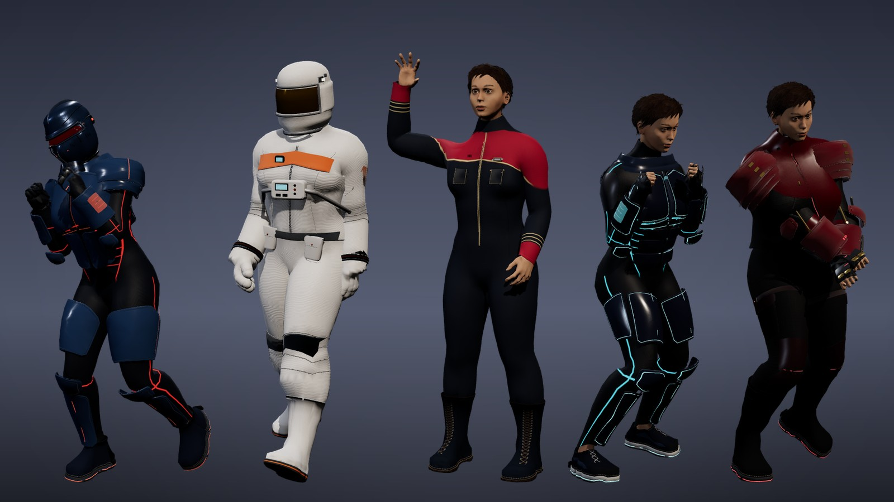
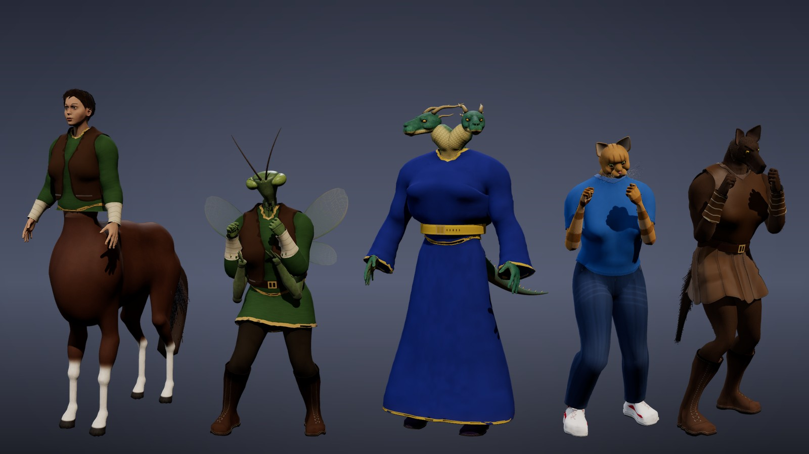
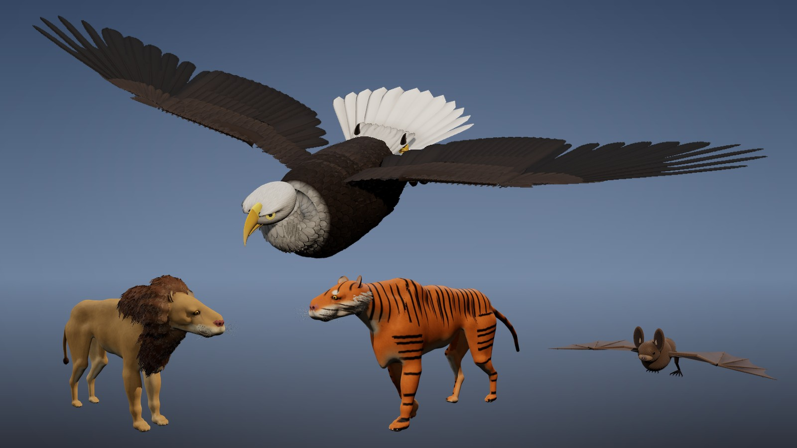
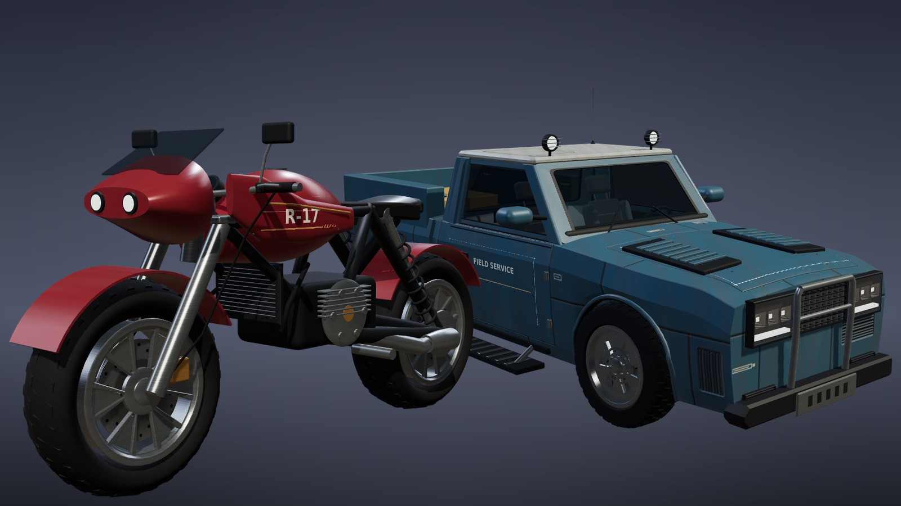
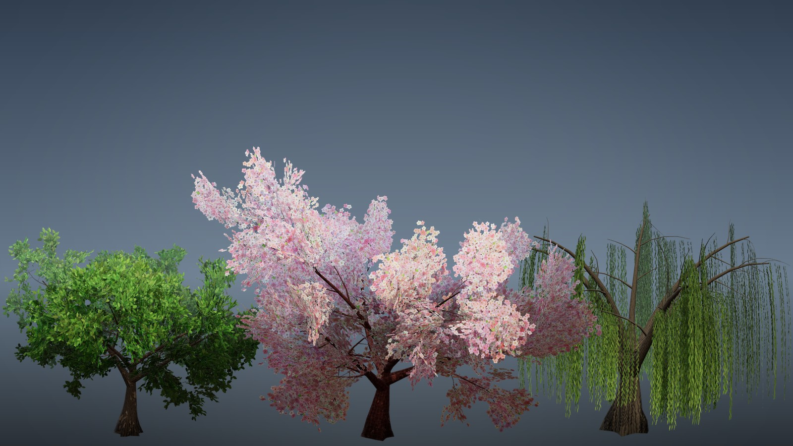
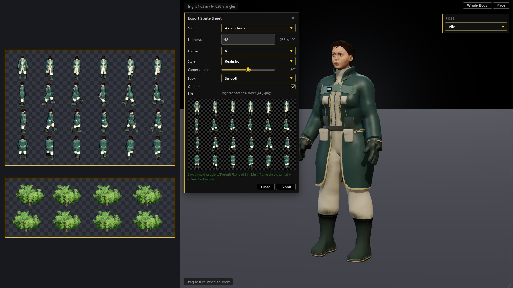
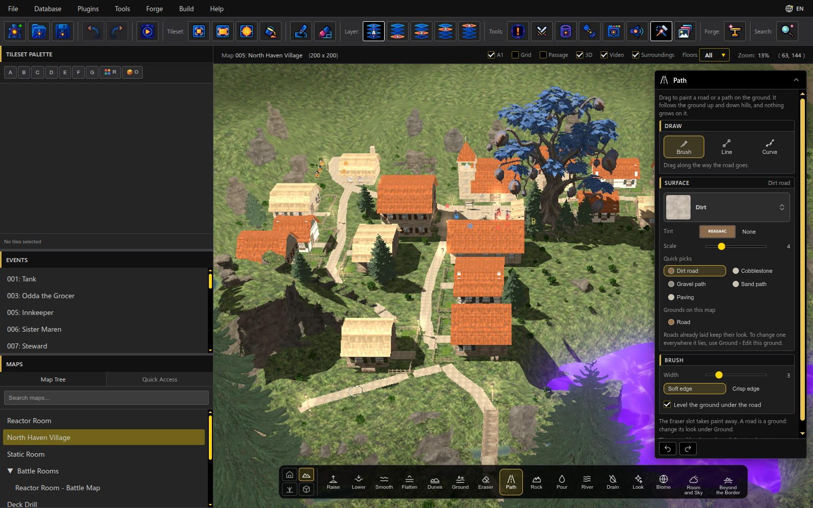
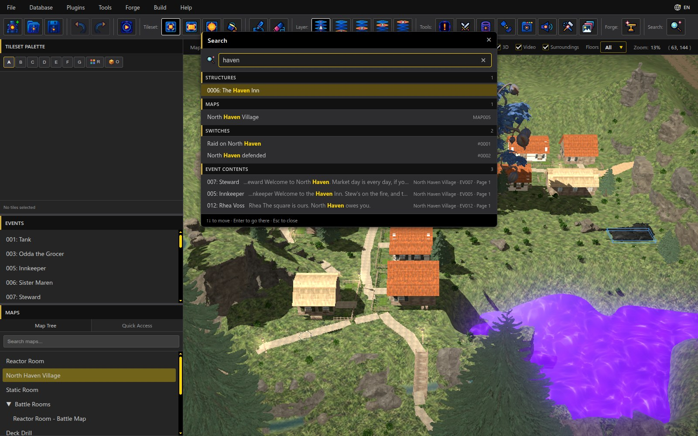

# RPG Reactor 0.99.2: Reactor Features, Search, Sprite Sheets from 3D, Faces with Feeling

0.99.2 brings Reactor Features (Reactor's own additions in one list you can switch off when a plugin does the job), a Search that finds anything in the project, sprite sheets from the 3D Character and Prop Builders with any number of frames and directions, new species, outfits, creatures, vehicles and trees, painted roads on 3D maps, and fixes for games imported from RPG Maker 2000/2003.

[Download the binaries on itch.io](https://psychronic.itch.io/rpg-reactor). GitHub provides the source release.

### Highlights

**Ready-to-wear looks:** Dress your hero in one click: a space marine with a sealed visor, an astronaut, starship crew, a neon Glow runner and a street samurai.

**Centaurs and more:** Meet the new centaur, plus insectfolk with compound eyes, the two-headed Hydrata, catfolk and werewolves, all wearing the same outfits as everyone else.

**Eagles, bats and big cats:** The rebuilt bald eagle glides on spread wings with a feathered head and hooked beak, joined by rebuilt bats, lions and tigers.

**Rebuilt vehicles:** Motorcycles and trucks come with real wheels, doors and headlights, and body styles you can tune with a few sliders.

**Trees in bloom:** Plant oaks, cherry blossoms and weeping willows that change with the seasons and sway in the wind.

**Sprite sheets from 3D:** Export a walking character with six frames per step, or a tree that sways in eight frames, ready for your 2D maps.

**Paint roads on 3D maps:** Drag the Path tool to lay dirt roads, cobblestone or paving that follow the hills through your village.

**Search everything:** Type a word in the new toolbar Search to find structures, maps, switches and event text, grouped and one click away.

The full list is in the [changelog](../../changelog/0.99.2.md).
