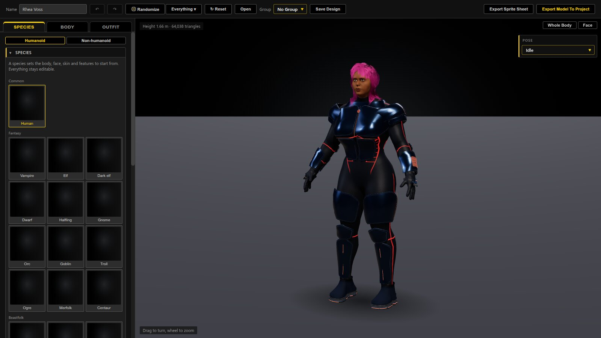
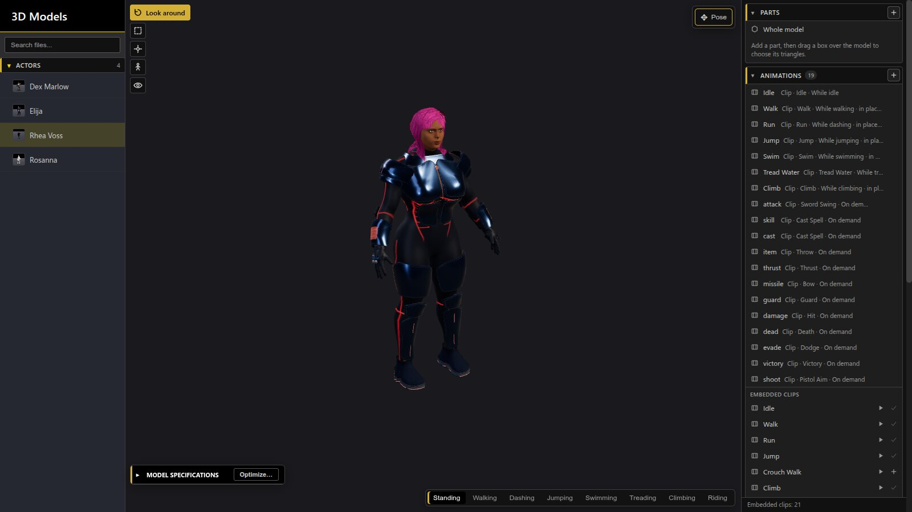
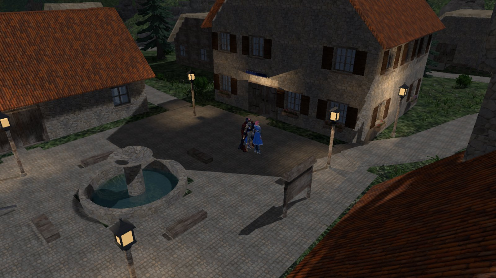
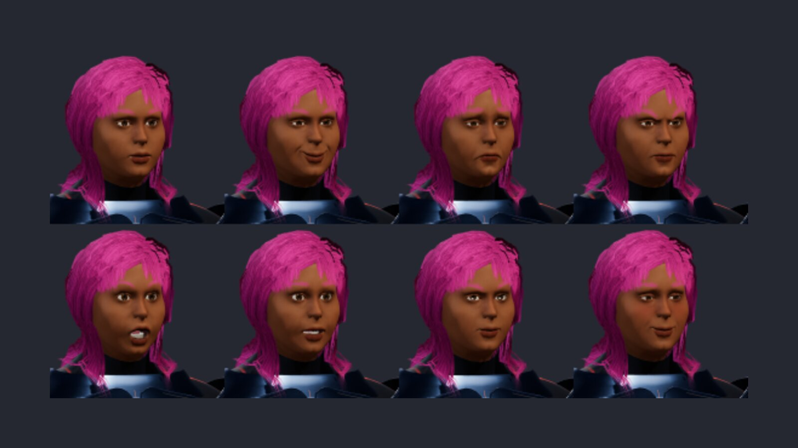
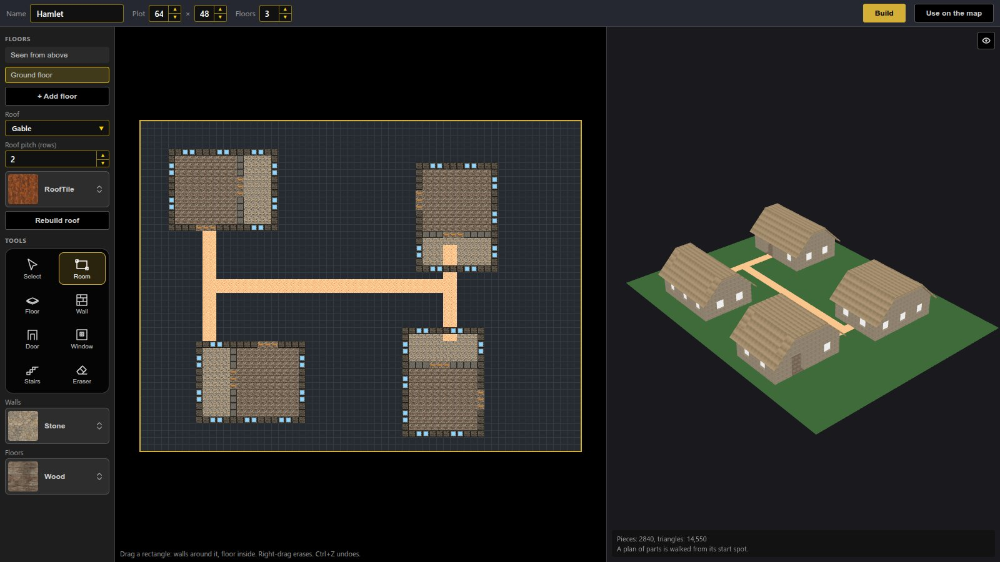
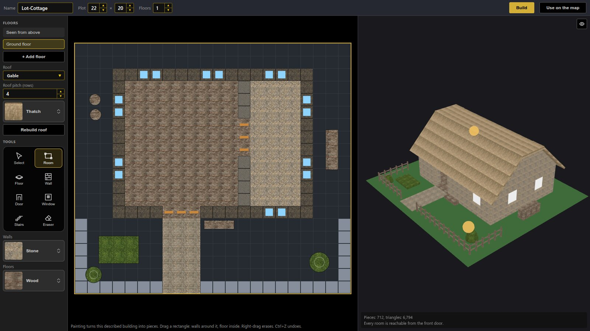

# RPG Reactor 0.99.3: Builder export fixes, reliable previews and complete blueprints

0.99.3 addresses bugs found while creating, exporting and testing characters and structures. The fixes cover the Builder, Database previews and game model loading, along with several battle, effects and deployment improvements.

[Read the GitHub release](https://github.com/Psychronic-Games/RPGReactor/releases/tag/v0.99.3). Pre-built downloads are maintained separately on [itch.io](https://psychronic.itch.io/rpg-reactor).

### Fixed today

- **Characters keep their exported detail.** Normal, glow, roughness, metalness and occlusion images survive loading. Database inspection uses the Builder's studio lighting and exported material settings. In-game lighting continues to follow the map.
- **Chibi proportions stay consistent.** A background rebuild could restore the ordinary body partway through a sprite sheet. Every frame now keeps the chosen style, and an interrupted export restores the character and camera.
- **Zoom and rotation agree.** Zooming in and out during ordinary Database model inspection keeps the orbit centred on the model.
- **Saved thumbnails appear first.** The model list reads existing folder pictures before rendering missing ones. Generated pictures are saved for future sessions without replacing existing artwork.
- **Structures keep the complete building.** The editor expands rooms, paving and nested plans beside manually placed pieces. Save/reopen retains geometry and attached lights, screens, models, water and event markers.
- **Shared builder controls and readable help.** The Structures floor plan and map share button rendering, icons and activation. Help stays clear of the Build bar, and the Structures floor list stays accessible in smaller windows.

### Also in this release

Visible worn equipment and the Tactical Grappler, configurable height reach with a live preview, the Demo's rebuilt heroes and enemy squads, HDR effect previews, deployment trimming for unused files, and fixes for effects rendering, worn-equipment shadows, key-config compatibility and dialogs in detached windows.

### Pictures

The Builder and export share their surface settings.

Saved thumbnails load first; exported materials retain their maps and studio appearance.

Explore North Haven’s streets and buildings in the Demo’s 3D world.

Exported faces keep their studio colors.

Nested buildings remain available for editing.

Rooms, paving and manually placed pieces stay together.

The complete user-facing list is in the [changelog](../../changelog/0.99.3.md); implementation details are in the [editor changelog](../../editor/changelog/0.99.3.md).
