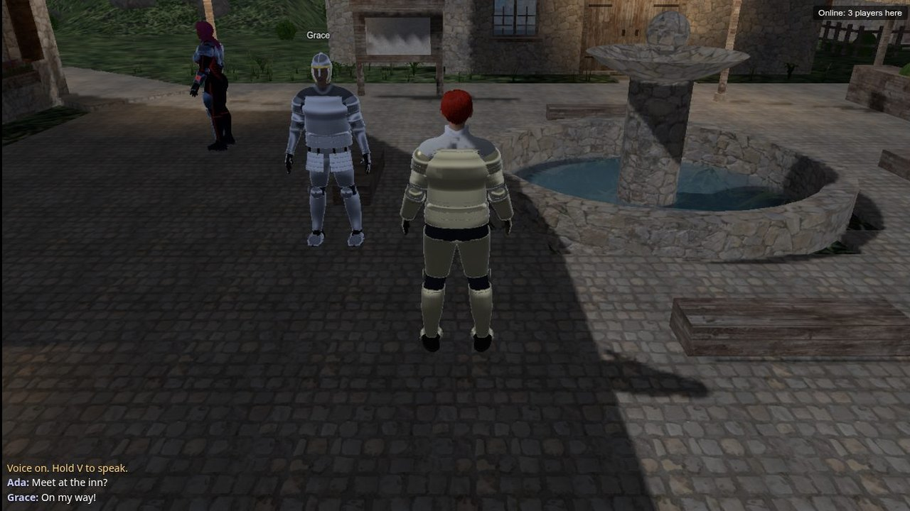
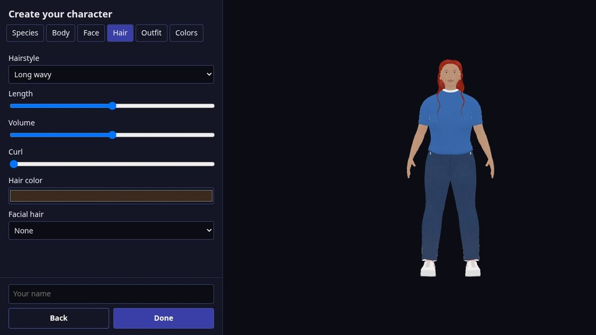
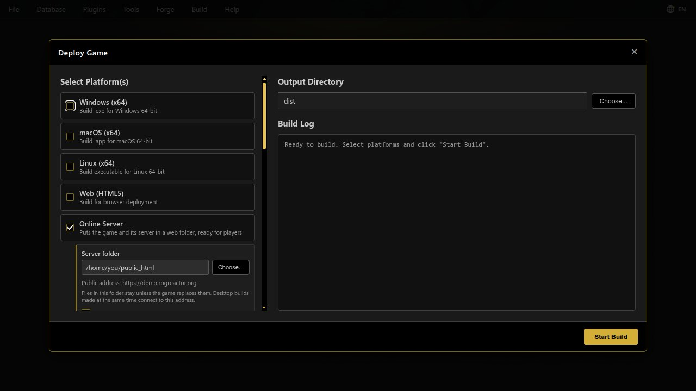
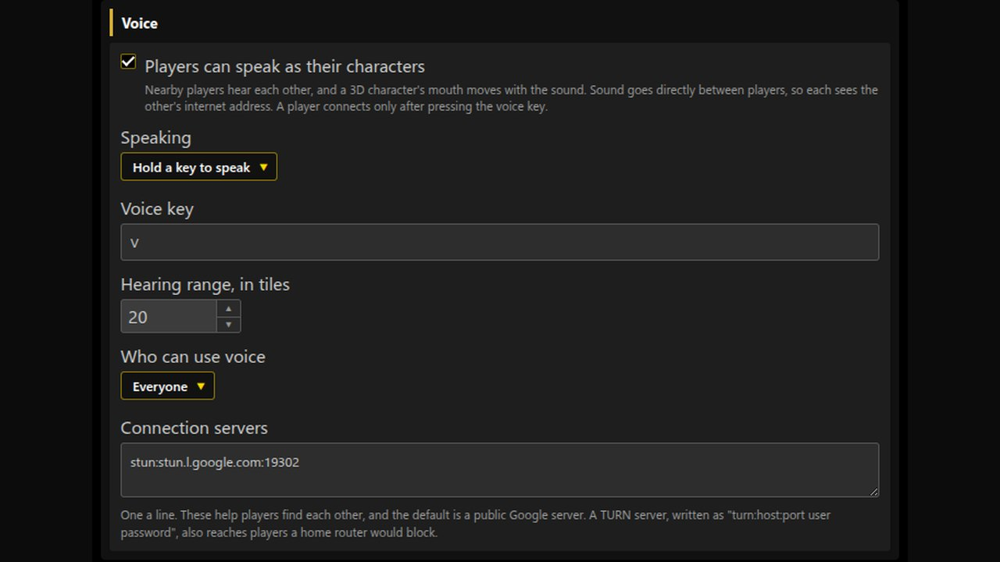
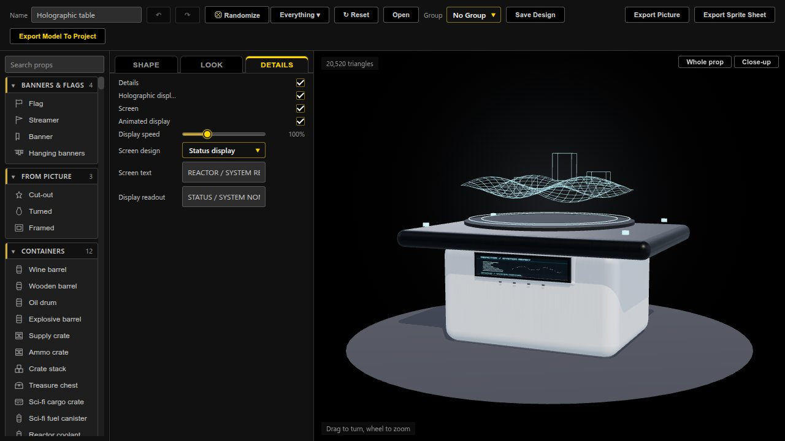
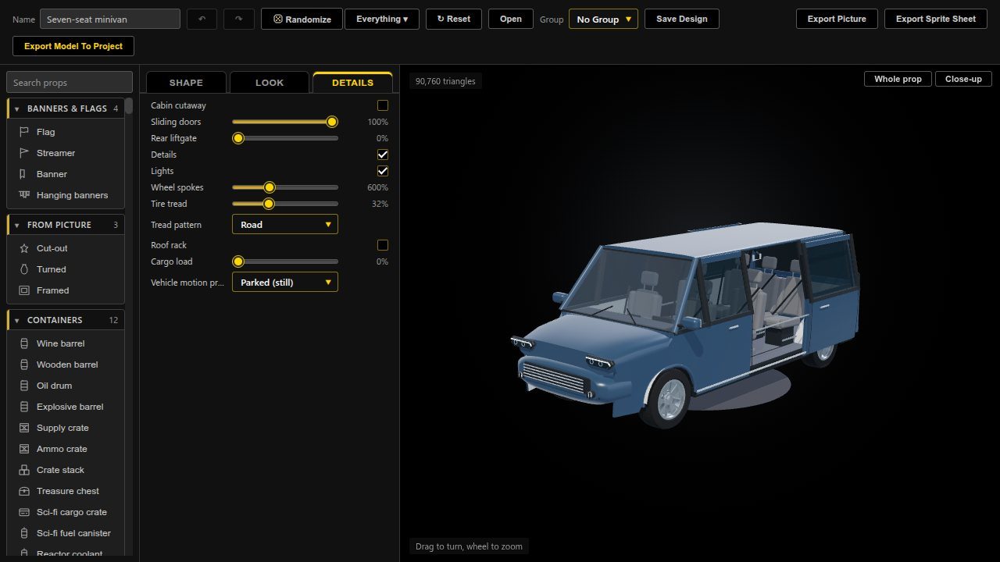

# RPG Reactor 0.99.4 - 2026-11-02

## Highlights

Build online worlds, let players create their own characters, and add movement to the Forge's characters, clothing and vehicles. This is the 0.99.4 source release. The [functional checkpoint CI run](https://github.com/Psychronic-Games/RPGReactor/actions/runs/41395251102) has failing checks; packaged downloads and native binary validation are tracked separately.

## Pictures

Player characters, names and chat share the same online world.

Players choose their appearance with the Forge-powered character creator.

Online Server writes the game and its PHP server to a web folder.

Set the speaking key, hearing range and who may use voice in Database → Online.

Screen design, animated readouts and holographic displays remain editable in the Prop Builder.

Sliding doors reveal the seven-seat cabin in the Prop Builder.

## Online worlds and player characters

- **Deploy an online world:** Online Server writes the game and a small PHP server to a web folder, without a database or router setup. Players see each other in 2D and 3D, with names and map/world chat. Accounts support saving across devices, sleeping characters, shared switches/variables and an owner administration page.
- **Create characters in the game:** Database → Character Creation offers actor choices or editable appearance controls, in online and single-player games. A Character Creation event command opens it later. Generated avatars are shared with nearby players online.
- **Speak as your avatar:** optional proximity voice carries sound between players and animates character mouths. Configure the speaking key, hearing range and access rules in Database → Online. Where supported, a small Node engine adds pushed updates and movement checks; other hosts retain polling.

## Forge characters, clothing and props

- **More natural motion:** exercise/resting poses include hip bridges, kneeling stretches, straddles, squats, jumping jacks, hamstring stretches, sit-ups, pull-ups, push-ups and crawling. Contact, shoulder, knee and ankle corrections accompany them. Independent Bust bounce, Butt bounce and Fat bounce controls carry movement into saved clips.
- **Skin and body controls:** choose Natural, Matte, Satin, Oily or Wet finishes and pore detail. Revised Cheeks/Cheekbones controls, facial joins, abdominal placement and lower-bust shading remain editable. Live sliders update between worker results, retain the selected pose and settle consistently on release. Saved-design opening and preview focus have been repaired.
- **Clothing, props and vehicles:** stronger material detail, lining, seams, embroidery and fitted construction; wearable symbols and editable Prop Builder clothing; rebuilt furniture, medical props and Wasteland vehicles. A seven-seat minivan adds sliding doors, a liftgate and a cabin cutaway. Regenerate older saved models to receive generator changes.

## Smoother presentation and compatibility

- Multi-frame sheets default on while preserving an explicit unchecked choice. Eight-frame walks export one complete walking cycle; picker, event-dialog and map-marker previews crop one frame correctly. Re-export older sheets to remove their idle-frame interruption.
- Online player avatars reappear correctly after map changes. Stationary event graphics stay registered with map tiles during camera interpolation. Rebellion's isolated Moletown check measured 6 pixels of drift before the correction and zero afterward in all four directions.
- Tactical status-panel readability, map-border reflection feedback, model materials, legacy imports and detached editor dialogs receive fixes. Rendering uses pinned PixiJS 8.22.0 and Three.js r187.

## Known issues and updating

Online features have been exercised on one server. Real microphones, separate home networks, TURN routing and production load still need testing. Character appearance and chibi quality remain under review, and the full CI run currently has failures. A complete Rebellion plugin-stack playthrough and native binary validation remain open.

Restart the editor and playtest after updating. Re-save generated models for new geometry, materials and embedded clips; re-export multi-frame sprite sheets for the corrected walking cycle. Existing project preferences and saved recipes remain editable.

Read the [technical changelog](../../editor/changelog/0.99.4.md), [online guide](../DESIGN-ONLINE.md), [Character Builder guide](../CHARACTER-BUILDER.md) and [open items](../OPEN-ITEMS.md) for details.
