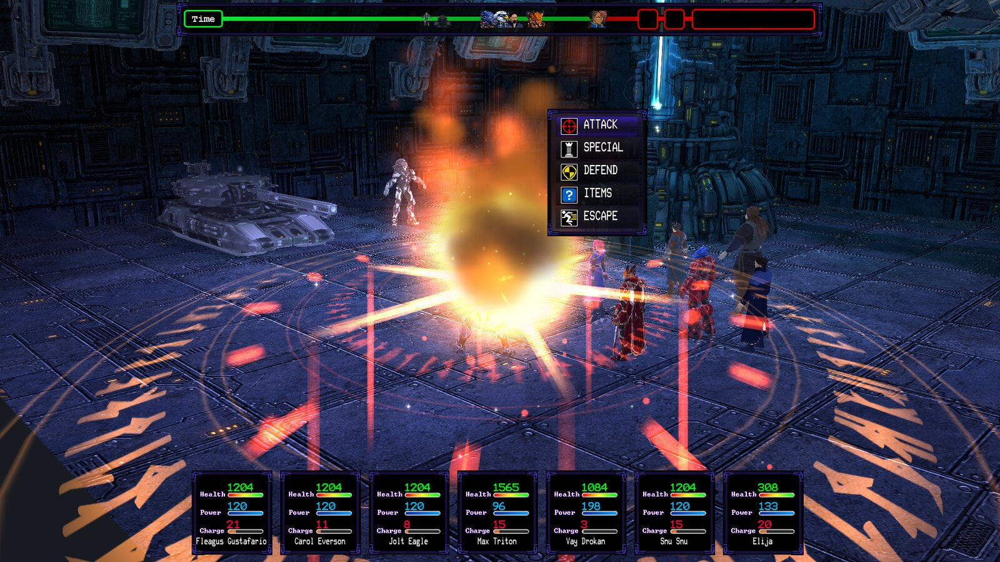
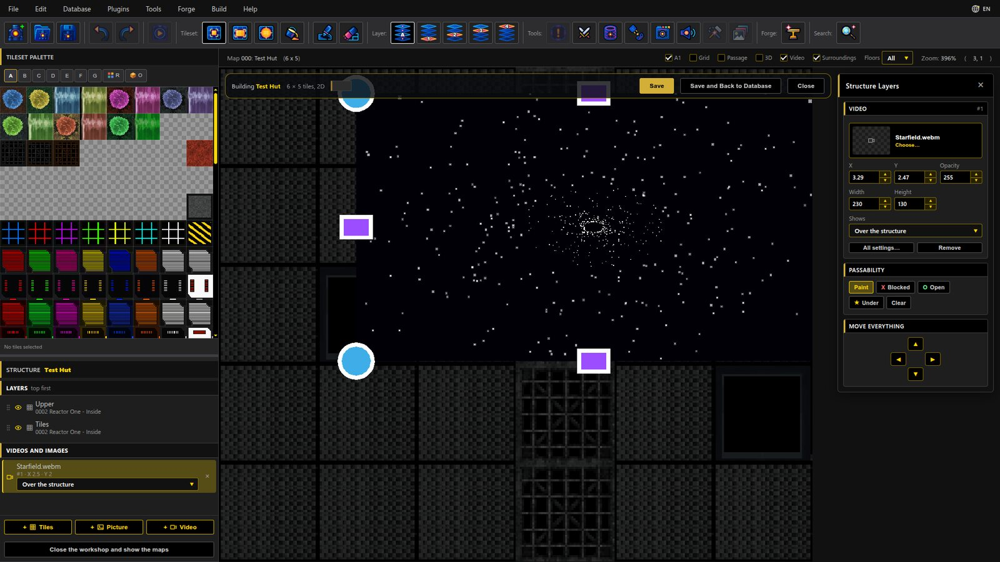
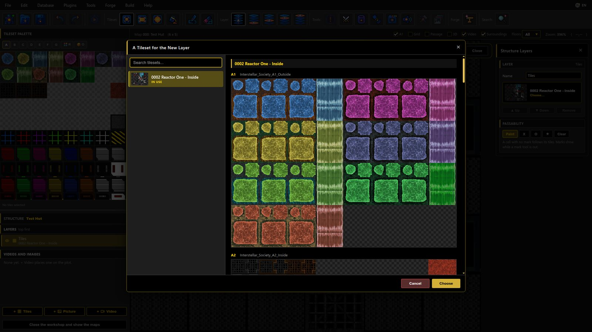
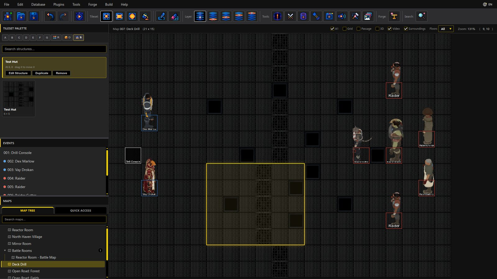
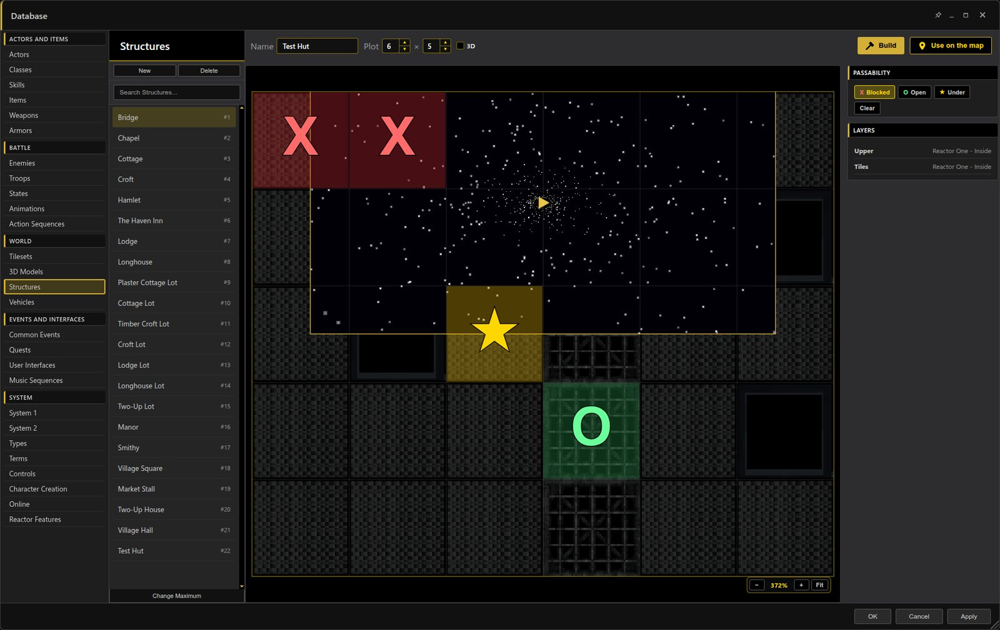
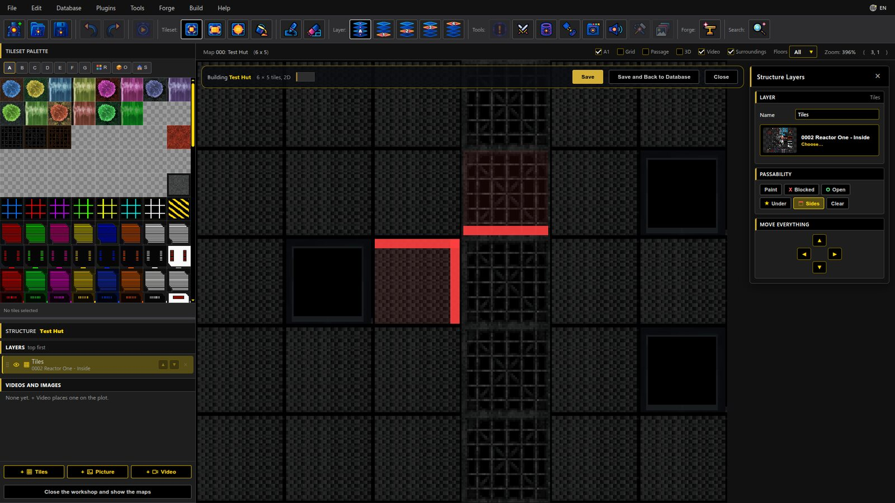
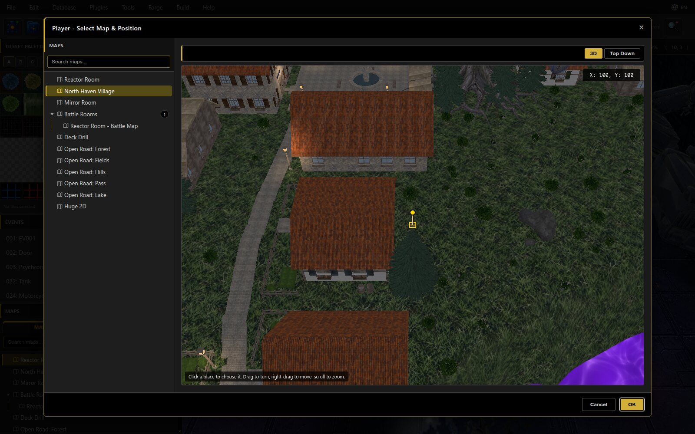
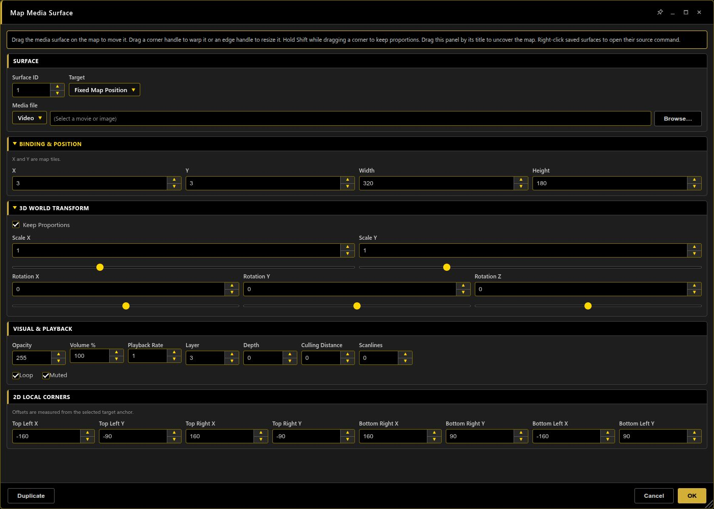
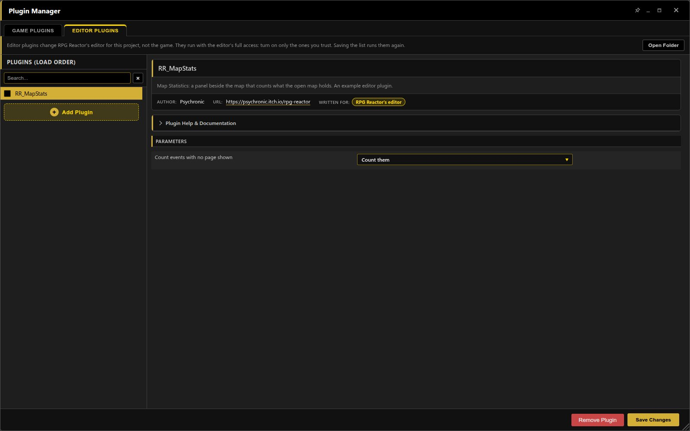

# RPG Reactor 0.99.7

## Highlights

Build 2D structures from any mix of tilesets, pictures and videos, with passability down to a single side, and place, move and copy them on your 2D maps from the tile palette. Share your projects, characters, props and effects on the Steam Workshop, earn Steam achievements in the editor, and give your own game achievements. Extend the editor itself with editor plugins. Every battle effect and sound in the sample project is now made with RPG Reactor's own generators, and 3D maps run smoother on weak graphics.

## Pictures

Every battle effect in the sample project is now made with RPG Reactor's own Effect generator, its sounds with the Sound Effect generator.

A 2D structure built on its own plot: its layers and videos listed on the left, the video in hand with its handles, its settings on the right.

A tile layer's tileset chosen from a picker that shows every sheet.

The S tab of the tile palette: click a structure, click the map. A placed one is selected, moved and copied right on the map.

Database › Structures: the structure fills the view and zooms, with its passability marks and its video.

Sides blocks just one edge of a cell, like a fence or a ledge, and the game honours it from both directions.

Transfer Player, starting positions and other places are chosen on the map itself, in 3D or from above.

The Media Surface editor in the editor's theme.

Editor Plugins: plugins that change RPG Reactor's editor for a project, beside the game's own plugins.

## New

- **Reactor One's battle effects, made with RPG Reactor:** all 128 of the sample project's battle animations now use effects built with the Effect generator, and its explosions, beams and blasts use sounds from the Sound Effect generator. Every asset in the sample project is RPG Reactor's own.
- **2D structures:** Database › Structures now makes 2D structures beside the 3D ones. Build one on its own phantom map with any mix of tilesets, pictures and media surfaces, mark its passability cell by cell (X blocked, O open, ★ walk underneath, as behind the back of a building), then place it on your 2D maps as often as you like. Change it later and every map it stands on follows.
- **Place 2D structures from the tile palette:** a new **S** tab beside R and O shows your 2D structures with a picture of each. Click one, then click the map; click a placed one to select it, drag it to move it, and right-click to duplicate, edit or remove it.
- **Building 2D structures:** the sidebar lists the structure's layers and its videos and images. Drag a layer to reorder it, or right-click it. Tilesets and pictures are chosen from pickers that show them. Videos are placed, moved and resized right on the plot. Move Everything shifts the whole structure a tile at a time.
- **Passability by side:** a 2D structure's cell can block just one or more of its sides (Sides, beside X, O and ★), like a fence or a ledge, and the game honours it from both directions. A structure's tiles keep their own one-way edges too.
- **A tileset picker:** every sheet of a tileset shown beside a searchable list, used wherever a 2D structure's layer chooses its tileset.
- **Steam Workshop in the Forge:** a new Forge page shares your project, and your Character Builder and Prop Builder designs, on the Steam Workshop. Designs you subscribe to go into your project (they open from each builder's Open, in the Workshop group); a project you subscribe to opens as a new project of your own, its plugins turned off until you turn them on. It works in the Steam version of RPG Reactor.
- **Editor plugins:** the Plugin Manager has two tabs, Game Plugins and Editor Plugins. An editor plugin changes RPG Reactor's editor for one project (a menu entry, a panel beside the map, something done when a map opens or the project is saved) without changing its source. The Demo has one to show how: Map Statistics, a button with its own icon on the main toolbar (and under the Plugins menu) that opens a panel over the map. Its icon is an SVG file beside the plugin: change it and the toolbar shows yours. A guide for both kinds of plugin is in docs/PLUGIN-DEVELOPMENT.md.
- **Plugins written for RPG Reactor:** `@target Reactor` marks a game plugin written for RPG Reactor itself, not for RPG Maker MZ. The Plugin Manager shows what each plugin is written for, and says when one is in the wrong tab.
- **A plugin only RPG Reactor can run:** RR_DayNight (in the Demo, off) runs a clock that moves a 3D map's light from night to day and back and lights tagged lamps at night. Under RPG Maker it does nothing.
- **Steam achievements:** seventeen achievements for the editor, from your first project and your first event to installing the Reactor Runtime, building, lighting and sharing on the Workshop.
- **Your game on Steam:** Database > System 2 has a Steam card: tick it and enter your game's own Steam App ID. The new event command Steam Achievement unlocks an achievement you made in Steamworks, by its API name. Desktop builds of the game carry what Steam needs. A guide is in docs/STEAM-FOR-GAMES.md.
- **Save Design in the Animation, Effekseer and Sound Effect generators:** each keeps what you made as a design with a picture, to open and change later, in groups of your own, without exporting anything. Designs from all three share on the Steam Workshop too, under their own Animation, Effect and Sound tags, carrying any textures they use; one you add opens straight in its generator.
- **Type a slider's value:** in the Animation and Effekseer generators, the number beside each slider can be typed into; press Enter and the slider follows.
- **Play from a server, for the editor too:** Deploy Editor → Web can make its package one small page that shows the editor from your own server.
- **Zipped and named as usual:** a Web build played from a server is also written as `<Game>-web.zip`, ready to upload to a store page; the editor's is `RPGReactor-v<version>-web.zip`.
- **Audio Player folders:** subfolders of BGM, BGS, ME and SE show as collapsible folders with their file counts, as in the file picker and the Resource Manager. Thanks to Xehanort88.
- **V-Sync, on by default:** games show each frame whole, in step with the monitor, so the picture no longer tears. F2 still shows how many frames a second the machine could draw. Database → System 2 → Advanced Settings has a V-Sync box to turn it off.
- **Opus audio:** `.opus` files play without being renamed to `.ogg`. Thanks to Xehanort88.
- **JPEG XL pictures:** `.jxl` images can be used anywhere a WebP can: pictures, parallaxes, titles, faces, characters, battlebacks, media screens and the Resource Manager. Lossless ones come out about a quarter smaller than PNG; lossy ones far smaller. Browsers without JPEG XL (Firefox) cannot show them in a web build.
- **Opening a project never downgrades it unasked:** opening a project in an older copy of the editor asks before replacing the project's newer engine files, and keeps them unless you choose otherwise. Thanks to Xehanort88.
- **Edit menu:** Undo, Redo and Search are in a new Edit menu, beside File, as well as on the toolbar.
- **RPGReactor.org in About:** Help → About and the welcome page link to the engine's own site.
- **NW.js 0.120.0:** the editor and the games it builds move to NW.js 0.120.0 (Chromium 157, Node 26), with H.264 and AAC video and audio through the matching codec build.
- **Mirrors facing each other repeat without end,** each reflection a little darker, as in a real house of mirrors. A room walled with mirrors used to show sky past the second reflection.

## Changed

- **Choosing a place on a map** (Transfer Player, the starting positions, vehicles and more): the map list looks like the Maps panel and searches the same way, each map opens fitted to the view, the wheel zooms and a right-drag moves around, and very large maps work. 3D maps can be picked in 3D.
- **The Maps panel:** maps nested many levels deep stay on one line, with guide lines, a map icon and a count on maps that hold others; opening or closing a branch keeps your place in the list.
- **A 2D structure's page in the Database** fills its space and zooms with the wheel; its videos show where they stand.
- **In the theme:** Map Properties, the Media Surface editor's cards and fields, the picture picker (it grows a small window it opens in, so a video's preview is large), structure headers and buttons, the map's scrollbars (thinner).
- **3D characters draw faster:** their triangles are now ordered so the graphics card reuses more of its work on each vertex, and a model drawn at a distance level now carries only the vertices it uses. On an Intel Iris Xe laptop the party's bodies took a quarter to two fifths less of the card's time; the picture is the same.
- **Smoother on weak graphics (Intel Iris Xe and the like):** a 3D map now waits behind the loading spinner until its shaders are built, instead of appearing and then crawling at a few frames a second for up to half a minute. Once it shows, it plays without the long stops. The game also no longer stops for seconds when it turns shadows down to keep its frame rate, and maps load about a quarter faster in playtests.
- **Auto quality keeps a margin on weak machines:** it now leaves the frame about a fifth of its time spare, so a busy moment no longer drops frames on a machine that was only just keeping up.
- **Maps with many event labels run several times faster:** hidden name labels (YEP_EventMiniLabel and the like) are no longer drawn. A town with 134 of them went from about 200 frames a second to over 1,000.
- **Battle Setup:** its panel has the editor's header and footer, and enemy pictures show at once once a model has been shown anywhere in the editor (the Database's Enemies page, a troop, the 3D Models section, or Battle Setup itself), even with the project in another folder.
- **Builder from the Tools menu:** Tools now opens Terrain, Foliage, Objects, Media Surfaces and Lighting in the Builder's bar, as its own buttons do.
- **The Builder's Objects group** (it was Models): the Library, Light, Screen (Media Surfaces), Select and Remove. Lighting and Media Surfaces moved here from the Build group; closing their panel comes back to Objects. The bar no longer keeps a picture of each model, a row that ran out of room: the Library opens the model picker.
- **Objects:** Select picks up media surfaces too (their editor opens). The Eraser no longer shows the last model as if it would place it. Lighting and Media Surfaces open where the bar's other panels do, so the bar no longer moves. Deselect and Remove stand out from their card.
- **The Builder, tidied:** Tools ▸ Build in the World is the heading of its group, with Build under it beside Terrain, Foliage and Objects. Every group's side panel has the theme's accent strip. Click a slot that is in hand again to put it down (back to Select). The mouse wheel scrolls the blueprint list (it zoomed the map behind it). Screen is called Media Surfaces.
- **The Media Surface editor is a window like the Forge's and the Database's:** beside the map at first, moved, sized, pinned, minimized or filled like them, and where you leave it. Its own drag and pop-out button are gone.
- **Image Layers and Lighting panels:** a header like Media Surfaces' (the theme's accent strip, the tool's icon, its name), and fields in the theme's colours: the number boxes for switches, variables and the rest have accent borders and arrows instead of grey on grey.
- **Select Event Command in the theme:** its header has the accent strip, its tabs are the Plugin Manager's, the search field and the scrollbar wear the theme, and each section is a card under an accent header. The Plugin Manager no longer draws a white strip down its list when it opens.

## Fixes

- **The party no longer vanishes for a moment** when it walks over a map border after climbing between levels (in the Demo: up the ladder to the High Lake, then along the trail into the Pass).
- **Choosing a place on large maps:** a very large map in the picker showed nothing and took no clicks or zoom.
- **Videos in placed 2D structures** now show on the map; they stood far off it.
- **Right-click menus** no longer open the browser's own menu beside them.
- **Hendrix HUD Designer:** games using it no longer stop with "setStyle is not a function" when the HUD loads its pictures.
- **Action games that remove enemies:** a game could stop with "Cannot read properties of null (reading 'screenX')" when an enemy off screen was defeated or removed (seen with Hendrix Action Combat).
- **Saving with Target Lock on:** a game using Hendrix Action Combat's Target Lock can save while the lock marker shows; it used to fail.
- **Pixel-art settings take effect:** a picture set to sharp pixels, by a plugin or by the project's pixelated rendering, now stays sharp when scaled or moving. Old-style text outlines from plugins draw as they did in RPG Maker.
- **Opening or creating a project no longer closes the editor:** choosing a folder crashed the editor with NW.js 0.120 (and every NW.js from 0.117; reported on GitHub, issue 90). Running the editor from a source checkout: the README now names the NW.js version to download, 0.120.0. Folders are now chosen in the editor's own folder browser, the same on Windows, Linux and macOS: a folder tree that follows where you are, your system's places and bookmarks, recent folders, back and forward, path completion, dates, hidden folders, new folder and rename, with projects marked.
- **First launch on Intel integrated graphics (Windows):** a game no longer spends its first session building shaders at a few frames a second; it starts on OpenGL, where the same first minute ran three to four times faster on an Iris Xe laptop.
- **Vulkan on Windows:** a game set to the Vulkan graphics backend now shows its picture. Its window stayed blank from the start, and the game behind it stopped drawing a moment into its first 3D map; once it showed, the lights' glow had static over it (all seen on an Intel Iris Xe laptop).
- **Vulkan on NVIDIA laptops (Windows):** a game on Vulkan no longer goes black when its window is resized, which it does once at start: the graphics driver crashed and the window never came back (seen on an RTX 3060 laptop).
- **Events stay on their tiles while the view scrolls:** on a monitor faster than 60 Hz, things made of events (barrel tops, doors, signs, building pieces) trailed the map by a few pixels while walking. They now move with it exactly.
- **Stray map pieces:** a block of the map could now and then keep tiles from somewhere else, or lose some, when returning to a place.
- **Lighting plugins and destroyed sprites:** a game using Sang Hendrix's 3D Light and Shadow could stop with "Cannot read properties of null (reading 'indexOf')". Setting a filter or mask on a sprite the game has already removed is now ignored, as it was in RPG Maker MZ.
- **MV plugins and Conditional Branch:** a game with Yanfly's Core Engine (and other MV plugins that replace event commands) no longer stops at its first Conditional Branch.
- **Play from a server:** the build no longer refuses every Game address with "must start with https:// or http://".
- **Event names fit their square:** an event's name on the map is drawn as large as its square allows and smaller for longer names, so short names are easy to read and long ones are no longer cut off.
- **Event borders at every zoom:** an event's square and outline in the map editor draw on all four sides however far you zoom in or out.
- **Browser editor:** About and the Audio Player are the size they are on the desktop; they used to stretch to fill the browser window.
- **Fountains and walled pools:** water poured inside a basin, a tank or a round fountain stays inside its wall instead of spilling a tile over the paving, and fills right up to a round wall. The North Haven fountain no longer has patches of grass around its rim.
- **Sniper shots in the Demo:** the hit is a sharp spark and spray on the target, timed with the damage, instead of a large swirl over it.
- **Knocked-out bodies and walls:** a character knocked flying into a wall now drops at its foot, instead of passing through the building or landing on top of a fountain.
- **Melee attacks in 3D battles:** a fighter who runs in to strike now stops in front of the enemy, a tank or a tall mech included, instead of running into it.
- **Spawn Unit:** How many now spawns that many units (the others on the nearest free tiles), and Stays on the map after the battle now keeps the unit there, through leaving the map and coming back. Both were saved but did nothing.
